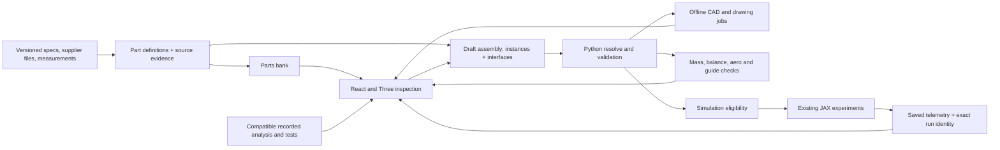

# Architecture and source contracts

Keep the installed Python/Pydantic/YAML/CadQuery/OpenCascade/FastAPI/JAX and
React/Three.js stack. This is a data and workflow expansion, not an engine change.
No dependency upgrade, new solver or paid service is required by the plan.

The return arrow represents validated draft commands. Browser code performs
selection, camera, layout, plots and display transforms, never flight/strength/
thermal physics. A drawing or asset is derived from a source record; it is not a
second design source.

## Entities that must remain distinct

| Entity | Required identity/content | Never substitute it for |
|---|---|---|
| `PartDefinition` |Stable library ID + revision; family; product/stock/template identity; native units/frame; parameter schema/ranges; materials; mass/cost basis; CAD refs; interfaces; sources/licence; missing fields | An installed location or a qualified joint |
| `PartInstance` |Unique occurrence ID; exact definition revision; quantity; placement; cut/preparation; chosen parameters; configuration lineage | A second mass charge for a display child |
| `Connection` |Two or more instance features; contact/engagement; retention/bond/process; tolerances; force routes; power/signal or motion constraints; evidence | Parentage, overlapping meshes, or guessed equal load sharing |
| `Representation` |Geometry revision; parent/feature map; exact assets; bounds/frame; detail maturity; parameter/source/kernel pins | Guaranteed manufactured dimensions, mass or inertia |
| `DesignDraft` |Base source hash or blank-template ID; immutable revision; instances, connections, required systems, assumptions, change history | The active RP1 baseline or approved hardware |
| `ResolvedCandidate` |Deterministic YAML/model snapshot; complete inventory; input hashes; assumptions; validation report; explicit missing fields | An eligible simulation if inertia/aero/recovery are missing |
| `Job/Result` |Exact candidate/model/source revision, method/version, resources, status, errors, output hashes, validity | A result on another draft or geometry |
| `Evidence` |Source locator, date/revision, units, applicable configurations, status, uncertainty/limits, measured/calculated/estimated basis | A universal approval or catalogue joint allowable |

Evidence status and geometry maturity are separate dimensions. A source-dimensioned
solid can have failed strength; a measured mass can coexist with envelope geometry.
Keep `unavailable`, `failed`, `superseded`, `estimated`, `calculated`, `measured` and
`physically_verified` distinguishable, with the scope of each measurement/test.

## Data ownership and persistence

- Current sources remain under `configs/vehicle/`, `configs/studies/` and recorded
  evidence. Initial bank entries are a read-only projection of those records.
- Later reusable authored definitions live under proposed `configs/parts-bank/`;
  every definition is versioned. Templates use allowlisted backend generators,
  validated parameters and named mating features. No executable source uploads.
- Proposed local draft snapshots live in ignored `output/design-drafts/<id>/` with
  atomic writes and content hashes. Preserve originals and prior revisions.
  IDs are server-generated; clients cannot choose filesystem paths. Multiuser,
  cloud sync and a new database are outside this release.
- Asset caches use candidate/definition/parameter/kernel/representation hashes.
  CAD-detail/mesh changes do not silently change physics identity. Physical source
  changes invalidate every dependent mass/fit/aero/analysis/run eligibility result.
- Results stay in their existing run/evidence paths. Importing a supplier STEP
  requires source/revision/licence/units/frame and a separate installation transform.
  It does not carry usable parametric design history or prove fit.

## Proposed API seams

The table is the phased target contract; the implemented subset and runtime evidence
are tracked in the backlog and current integration report.
Existing `/api/design`, experiment, run and Analysis APIs remain compatible.

| Phase | Interface | Behavior |
|---|---|---|
| P1 |`GET /api/parts-bank` and definition detail |Read-only source-pinned bank; unknowns/conflicts explicit |
| P5 |`POST /api/design-drafts`, `GET /.../{id}` |Fork/blank/save revision; frozen sources untouched |
| P5 |`POST /api/design-drafts/{id}/commands` |Add/remove/replace/connect/set supported parameter; validate base revision and return changes/errors |
| P5–6 |`POST /api/design-drafts/{id}/resolve` |Create immutable effective configuration or field-specific blockers |
| P2–3/5 |`POST /api/design-drafts/{id}/preview-jobs` |Explicit bounded offline geometry/drawings; cached by source hash; progress/cancel |
| P6 |`GET /api/design-drafts/{id}/checks` |Backend recorded checks, missing fields, invalidations and margins |
| P7 |Existing experiment API, extended with resolved candidate ID |Only admitted full configurations; independent run identity/settings |
| P9 |`POST /api/design-drafts/{id}/export-jobs` |Identity-bearing CAD/drawing/BOM pack with scope/status; no purchasing or publication |

Draft commands require a matching base revision; stale writes fail recoverably.
Unknown IDs, foreign asset paths, duplicate occurrences, invalid units, cycles,
quantity errors and unsupported parameters fail with useful messages. Local API
remains bound to loopback with appropriate origin handling; no deployment change.

## Jobs, invalidation and resources

A slider edit does not launch CAD/FEA or a flight. The user previews a revision or
runs an experiment explicitly. Use existing worker/status patterns and one local
CPU job at a time. Before a new packet declare cases and time; initial geometric
cases: at most120 wall/90CPU seconds each, maximum600CPU seconds per packet. One
focused correction is allowed; repeated invalid/time-limited cases stop and yield
a source/method decision. Never rerun the closed component exporter or stopped
thermal campaigns. Native packets have their own owner/action/time limits.

Changing stock thickness invalidates geometry, joint clearance, mass/inertia,
stability and affected analysis. Changing an installed position invalidates mass
moments and fit/aero assumptions. Changing a label does not. The backend declares
these dependencies; the UI shows stale/blocked results and never presents an old
pass as a current one.

## Technical references and limits

CadQuery supports reusable components and geometric assembly constraints; those
constraints position shapes and do not establish joint strength. Its export
formats include STEP, SVG/DXF and assembly glTF, while its Python source retains
parametric intent. Reuse the installed versions and existing generators.
[Official assemblies](https://cadquery.readthedocs.io/en/latest/assy.html),
[official import/export](https://cadquery.readthedocs.io/en/latest/importexport.html).

Three material clipping is a display operation, and Pydantic validates data
contracts; neither proves engineering adequacy. Use the installed source behavior
and focused tests for each implementation.
[Three Material](https://threejs.org/docs/pages/Material.html),
[Pydantic models](https://docs.pydantic.dev/latest/concepts/models/).
