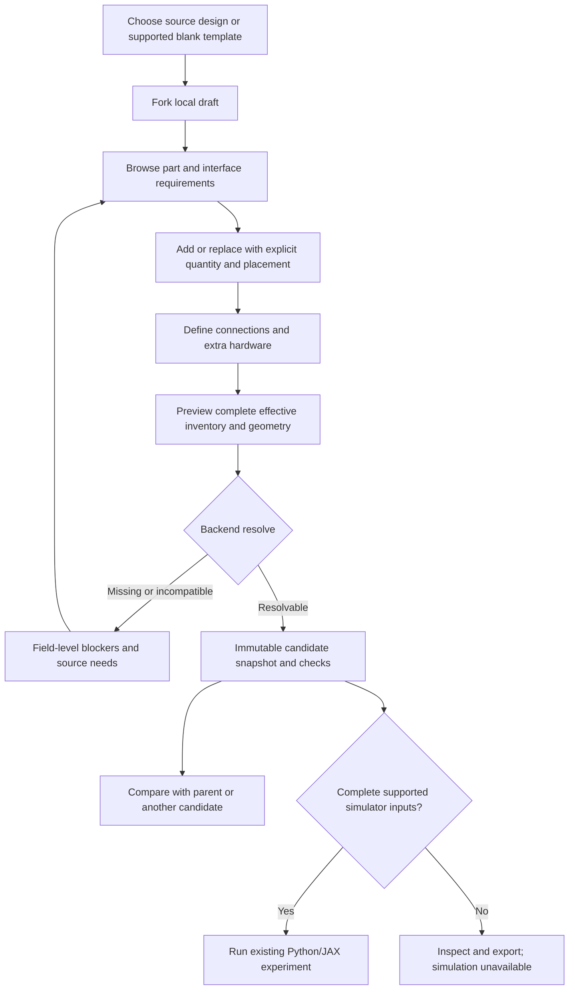

# Parts bank, virtual assembly and alternative testing

## What belongs in the bank

The bank is a source-owned engineering library, not a shopping cart or a mesh
folder. Include:

- Custom parametric parts: nose, stock-cut fins/tabs/rings, tube cuts, sleeves,
  brackets, carriers and shields where their definitions exist.
- Purchased product revisions: exact commercial motors/hardware, sensors,
  controller, cells, connectors and recovery components, retaining uncertainty.
- Stock definitions and preparation: sheet/tube dimensions, grain, thickness
  windows, cut lengths, adhesive/finish and process allowances.
- Subassemblies with a complete internal inventory and external mating features.
- Nonphysical allowances as explicit budget rows, never drawable hardware.
- Unadopted/historical alternatives as research references with stop reasons.
  FP1/FR1 are not installable complete qualified fin replacements.

Initial import preserves all55 RP1 records and current stable IDs. Entries are
scoped source definitions, not claims of universal interchangeability. Repeated
geometry children remain tied to one mass line. Manufacturer assets need an
identified licence/source revision and installation frame. Availability and price
have dates; owner stock is unknown until confirmed. Unknown cost is not zero.

## Required bank detail

Each entry exposes ID/revision/family, product or custom-template identity,
function/learn text, materials/process, dimensions/units/tolerances with source
locators, geometry maturity/coverage, parameters, named interfaces, mass/CG/inertia
basis, costs/stock quantities, applicable findings, remaining measurements and
supported actions. Missing fields are explicit. A vendor's generic material
strength is not a finished joint allowable.

Keep the documented retainer19002/009750 identity conflict and current tube versus
legacy note mismatch visible. An unresolved recovery-controller product cannot
inherit another product's mounting pattern. Source-defined geometry may be
inspectable while blocked for reuse as exact purchased hardware.

## Installed instances and connection graph

A library record owns shape and product intent. An occurrence adds placement,
quantity, cut/preparation and selected interfaces. Connections own contact,
engagement, process, retention and evidence. Show both an assembly tree and a
connection graph: tree parentage alone does not establish a force route.

| Interface family | Required definition before it can pass |
|---|---|
| Tube/sleeve/splice |Datum and axes, OD/ID and ranges, insertion/overlap, stop, bond region, material/moisture/temperature basis, assembly access |
| Fin/root/slot/ring |Actual continuous stock/tab, slot dimensions, support/contact faces, adhesive access, engagement, tolerances, installed flexibility and load evidence |
| Motor/thrust/retention |Exact case/nozzle/thrust-ring geometry, forward/reverse force paths, retainer identity, liner termination, hot clearance and independent removal |
| Recovery |Harness branches, actual end connections, anchor contact and structural route, heat/chafe protection, slack/packing/extraction, opening cases |
| Electronics/power |Board/cell envelopes, holes/fasteners, connector/pin/net/voltage/current and supply separation, service and strain relief |
| Mechanism |Joint axes, degrees of freedom, limits/stops, actuator/linkage, moving mass, wiring/slack, sampled/continuous clearance scope |

Compatibility is not one green checkbox. Report `compatible_geometry`,
`incompatible`, `unknown`, `engineering_open`, and `simulation_blocked` separately.
Nominal overlap, assumed rigid supports and attractive visuals cannot close a
connection. Adapters must be real counted parts with a source and their own checks.

## Builder workflow

Start with explicit **Add**, **Replace**, **Connect**, **Preview** and **Save draft**
actions, not a precision drag-only editor. Keyboard selection and numeric
position/dimension entry remain usable. Provide undo/redo, reset-to-parent,
differences, pending/failed job states and cancelled-job recovery. A blank draft
shows required subsystems and incomplete placeholders; it cannot fly as an empty
or partially populated body. Full freeform surface modeling is outside scope;
new custom shapes enter through backend templates or source-owned CAD imports.

A motor change selects a complete supported vehicle or resolves all changed
mount/retainer/thermal/recovery/mass/aero dependencies. Do not offer a G54 label on
an unchanged G80 assembly or retain future servo/gimbal mass in dedicated G80.
G12/finless mechanisms have separate configuration and controller prerequisites.

## Comparing alternatives

Compare exact snapshots, including required adapters, fasteners, adhesive, wires,
finish and service items. Removed mass is credited only where its function is
replaced. Distinguish stock procurement cost/quantity from installed material and
mass. Show the full separate50g allowance,20g adverse/motor probe and55/68g
harness cases where applicable. Keep15m/s formal versus15.5m/s planning,1.5m
reference and unconfirmed longer-guide cases separate.

All physical results come from backend tools. Show mass/CG/full inertia only when
their basis exists; never use zero for missing inertia. The aerodynamic-force
point must follow the actual geometry and a valid method. Large-angle, finless,
thermal, flutter or controller bounds stay explicit. Existing D1 load/material
criteria remain unchanged. Do not manufacture a passing design by changing them.

For paired experiments, copy matching environment/settings explicitly, list every
difference and record complete model/source hashes. A parameter probe is a
sensitivity, not a statistical confidence interval. A component or static pass
never transfers to the whole installed vehicle, and a G80 pass never clears G54
or G12. Failed and rejected alternatives remain accessible with their reason.

## Safe promotion and exports

Saving/selecting a draft is reversible local authoring, not adopting hardware.
Export a new identity and source YAML for ordinary version-controlled integration;
never overwrite frozen RP1. Any later adopted design needs its applicable
engineering evidence and the existing focused-PR checks. No new independent
owner-review gate is added for routine code/draft changes. Existing owner gates
for purchases, physical work, paid runs, WO-10 and flight remain intact.
