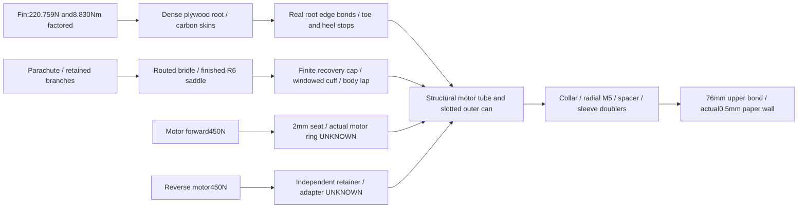

# A1 connection decision — hold detailed admission

**Additional source-layout failure:** the [read-only occupancy audit](wo03-a1-occupancy-audit.md)
finds the proposed thrust seat intersects the unchanged mica liner and foil
atz1193–1195. They extend toz1200. No liner trimming or motor relocation is
adopted; old seat strip arithmetic is not a geometrical acceptance result.

**A1 makes the local interface explicit but is not a buildable accepted vehicle.**
The bounded aft fit screen passes within its stated inputs. The complete mass
and conservative radial-bolt connection screens fail. No whole-vehicle CAD,
FEA, heat or free-flight calculation is admitted. C1/A/B and rejected R1/C2/C3
remain frozen; G80 first, G54/G12 separate. Full WO-03 remains open.

Identity: `G80_A1_connections_20261102_v1`,
[configuration](../configs/studies/wo03-a1-connections.yaml),
[immutable record and exact executed sources](../runs/wo03-a1-connections-20261102-v1/record.json).
One CPU packet used0.326CPU/0.372wall seconds versus20/30s. It ran once, with
two mass cases and six existing guide calculations. Source/code preparation
and source/export checks are not repeated engineering design runs. No capped or
unchanged rejected calculation was rerun.

## Actual arrangement and assembly

All stations are mm from nose, positive aft. Radius is from centreline.
These dimensions define local **concept geometry**, not completed CAD.

| Feature | A1 definition | What changed / consequence |
|---|---|---|
| Connecting sleeve |G11 ID61.4/OD63.4, z842–962, length120 |Explicit replacement of cardboard ID61/OD64,z868–972. Thinner wall but denser material and longer upper overlap; mass/holes counted. G80 study only. |
| Upper bonded overlap |z842–918, length76; nominal radial adhesive0.8 |Real paper body bore65/OD66, wall0.5. No rigid ground or generic G11 allowable for paper. Full adhesive volume plus25% process charged; capacity uses75% coverage. |
| Stop |Integral G11 annulus ID63.4/OD66,z918–922 |Replaces actual4mm ASA flange, not the old29mm envelope. Compression contact at upper/can ends, no axial tension credit. |
| Indexing |Three integral keys6/4/4 wide,z922–942,R31.7–32.5 at0/120/240deg |Can has through-slots6.6/4.6/4.6. Unique wide key establishes orientation. Indexing is not the primary recovery restraint. |
| Removable aft overlap |z922–962,length40 |Can bore64.4. Bolts removed before at least40.5mm extraction. No permanent adhesive in removable sleeve/can annulus. |
| Reinforcement |G11 collar ID66.4/OD70.4,z937–967; three curved inner sleeve doublers30axial×25arc×2radial |Collar bond0.2; slot/keys masked during bonding. Collar and bolt heads change external geometry and aerodynamics. No old CP/drag acceptance is transferred. |
| Positive axial retention |Three specified partial-thread M5×16,5.4 holes,z952,0/120/240deg; fitted G11 crush spacers |Plain shank>=8, head8.5×5, two10OD/5.4ID×1 washers and8AF×4 nut per bolt. SKU, clamp, locking, hole and hot properties remain unqualified. |
| Harness |Six legs at centreR21 throughz900–962; fan toR24 atcapz1004; saddleR6 unchanged |Real12.7mm radial width and±6mm tangential offsets counted.100mm extra service slack and2g chafe allocation charged; actual chafe guide/connector access unqualified. |
| Motor |R15.8 body/linerz1069–1195, independent retainer reservationR23,z1195–1227 |Joint hardware is102mm ahead. G80 seat ID29.2/OD34.4,z1193–1195 rests on shortened structural tube ending1193. Current motor ring/nozzle remains unknown. |
| Fin axial stops |Three toe blocks1073.5–1090 and heel shims1190–1190.5; radial15×tangential8.98 |Contacts front/rear rings and dense root. Replaces4g undefined pin allocation, not a claim of positive radial fin capture. Permanent bonded fin service differs from removable motor service. |
| Bonded centering rings |ID35/OD63.8,3 thick, centres1072/1192 |Explicitly replaces ID34.4/OD64.4 rings to create0.3 nominal inner/outer adhesive regions. No zero-volume glue/air path or rigid annular support. |

Assembly concept: inspect tube stock/holes first; bond sleeve/stop/key assembly
into the upper body with defined centering/tooling and no glue in aft slip area.
Build permanent fin/root/tube/ring/can assembly and collar, masking indexing slots
and removable surfaces. Route branched harness before closing; engage wide key,
seat the stop, fit radial spacers to measured gap and install accessible external
bolts with washers/nuts. Inner nuts require access before final closure; no
captive-nut geometry or tool sweep is qualified. This access is an open item,
not solved by the rendered bolt envelope.

For motor changes, remove only the independent rear cap/retainer and withdraw
the motor aft; do not disturb primary recovery loops or service-joint bolts.
For an aft-module change, unload and remove three service bolts, translate40.5mm
with the counted100mm slack, then access/disconnect the retained recovery
connector. Actual connector, chafe sleeve, bend radii, nut tools and extraction
paths still require local CAD and physical checks after admission. All diagrams
and sequences are illustrations, not validated clearance animations.

## Clearance decision

| Region | Minimum / nominal / maximum | Decision and evidence limit |
|---|---|---|
| Old frozen A/B coupler/can, cold |0 /0.2 /0.4 radial |Preserved failure versus0.1mm. No retroactive pass. |
| A1 sleeve/can, cold |0.3 /0.5 /0.7 radial |Calculated pass under±0.1 per radial surface. Target tolerances require actual stock/process inspection. |
| A1 differential hot/wet/ovality bound |0.1171 minimum /0.5 nominal-cold /0.8829 bounded maximum |Only0.0171mm margin over0.1. Sleeve150C/can45C,25e-6/K bound,0.05mm wet growth and0.05mm ovality reserve. Not measured material behavior; actual acceptance unknown. |
| Key flank,6mm wide |0.142313 minimum /0.3 nominal /0.4 cold maximum per flank |Calculated minimum>0.1. Total side clearance is twice per-flank; no primary load-sharing credit. |
| Keys4mm wide |0.144938 minimum /0.3 nominal /0.4 cold maximum per flank |Same qualification limitation. |
| Upper bond gap |Cold0.6 /0.8 /1.0; declared combined minimum0.396975 |No thermal expansion credit for paper bore; paper shrink/wet behavior and cured thick-bond strains unresolved. A bonded layer is not an operating air gap. |
| Motor-tube/ring and ring/can glue regions |Cold0.1 /0.3 /0.5 radial each |Real adhesive volume; differential hot strain, cure and contact pressure unknown. Cold gap is not thermal bond qualification. |
| Harness versus sleeve |OldR24 gives−0.991904mm; newR21 gives1.939385mm after0.7 losses |Calculated rectangle/radius bound. Inner doubler sectors have8.934733deg separation after bounds; no moving strap/connector simulation or physical proof. |
| M5 length stack |12.5 nominal through nut;13.3 declared maximum,16 length |>=2.7mm thread protrusion; nominal defined stack, actual SKU/threads/preload/washer tolerances remain unknown. |

The manufacturing bounds are **proposed inspection targets**, not values
demonstrated by catalog tolerance charts. Atlas sheet CTE/water uptake does not
qualify wound tube behavior. See [primary-source supplement and owner test plan](wo03-a1-connection-sources.md).
No G54/G12 shared sleeve, keyed interface or upper assembly is adopted.

## Force routes and local checks

Loads are already factored once. Motor450N cases remain separate from severe
parachute loading. The combination of whole recovery force and whole fin-axis
torque at one bolt is an explicit conservative envelope, not a measured
simultaneous flight event or justified equal bolt sharing. It can reject
admission but cannot establish actual installed failure strength.

| Check, adverse full mass | Calculated result | Acceptance boundary |
|---|---:|---|
| One service bolt combined bending/shear proxy |463.661MPa |Exceeds unchanged200MPa estimated hot-steel screen. Single-lap eccentricity and gap cannot be ignored by checking shear alone. Hand beam bound, not actual stress field. |
| Can/collar hole bearing |168.841MPa demand |Drilled hot G11 bearing allowable unavailable. |
| Sleeve/doubler hole bearing |157.585MPa demand |Not compared with25MPa axial or1MPa glue-shear screens. |
| Sleeve end shear-out |53.968MPa demand |Hole centre10mm from sleeve end; actual geometry/layup/hot capacity unknown. Research edge-distance guidance is not an allowable. |
| Sleeve net axial section |12.846MPa |Below25MPa scalar estimate; does not close holes, local shell bending or buckling. |
| Upper lap mean shear |0.203486MPa on11353mm² effective area |Below1MPa screen, but peel, paper substrate, cure and hot/wet capacity remain open. |
| Upper lap edge-normal proxy |0.012852MPa |Peel allowable unavailable. No pass from low mean shear. |
| Upper paper shell axial demand |22.454MPa |Actual paper hot/moisture/tear/buckling allowable unavailable; G11 strength cannot qualify it. |
| Root outer/inner reactions |821.222 /−600.464N |Sum matches220.759N. No second DF3. Actual898mm² edge area replaces old assumed1200mm² spreading patch. |
| Root outer normal demand |0.914502MPa |Normal/peel demand, **not** a1MPa shear pass. Skin/root transfer and installed flexibility remain unqualified. |
| One root web carrying all motor thrust |0.501114MPa mean axial bond shear |Necessary screen only; combined normal/peel and actual shear distribution unknown. |
| Toe/heel axial contact |1.707179MPa |Only contact demand; plywood bearing/edge and bond details require evidence. |
| Unbraced3mm ring half-circumference strip bound |78.577MPa |Above25; do not pretend centering rings provide rigid thrust support. Primary proposed thrust path uses tube end/root webs. Actual ring load split and bending remain unknown. |
| New2mm thrust-seat lip half-circumference strip |16.318MPa |Below25 estimate under declared contact arc; actual current motor flange contour/contact is unavailable. |
| Recovery cap effective spreading width needed |123.210mm |Actual annular spreading/finite cuff connection unestablished; no equal saddle sharing or fixed plate. |

The toe/heel contact screen conservatively reuses the220.759N factored fin force
as a separate axial envelope; it is not a measured axial drag force. The bolt
beam proxy uses an explicit4.3mm bearing-separation bound and momentF×span/2;
it is a conservative hand bound, not a solved three-dimensional lap-joint stress.

Upper adhesive shear moduli1/10/100MPa give constituent slip bounds
0.162788/0.016279/0.001628mm. They are illustrative stiffness inputs, not
measured properties or complete support movement. Paper, hole, tube, ring and
cap flexibility, local shell deformation/buckling, torsion and installed flutter
remain unknown. Isolated panel evidence is not installed fin/root evidence.

No new thermal result exists. New sleeve/collar/ring/seat contacts, actual
adhesive-filled gaps and real slots must enter the unchanged required matrix,
including300C case/contaminated foil/35C ambient through burn/soak, with45C
substrate screen. Current78010 polymer case replaces no historical thermal
boundary assumption without matching evidence. Retainer20g/adapter5g remain
allocations, not verified purchased fit or hot450N capacity.

The routed-leg bound covers the sleeve interval and fan-out to the cap. It does
not establish how six finite-width legs converge onto the exact retained
connector/junction, their bend/chafe lengths or tool access. That junction is an
explicit remaining geometric and mass uncertainty, alongside unallocated service
reserves; the current totals are complete accounting of the selected estimates,
not a claim that every installed item or final harness length is known.

## Integrated mass and admission

Values below are saved **reference-model screens**, not validated aerodynamic
performance of the new collar and bolt heads. CP966.827598mm and source drag
are reused hypotheses; validated new CP and full intrinsic inertia stay null.
The maximum bolt-head reservation reachesR41.2 (local diameter82.4), so the
external change must not disappear from the next aerodynamic assessment.

The subsequent generated tables are copied from the immutable A1 record.

|Case|Subtotal+50 / total g|CG loaded / burnout mm|Reference stability cal|Guide1.5 /1.8 /1.971 m, m/s|Formal / planning baseline headroom g|Severe recovery N|
|---|---|---|---|---|---|---|
|nominal|1024.762+50 /1074.762|853.301 /835.847|1.720096|14.059073 /15.407706 /16.127549|-116.364 /-170.908|2267.985|
|additional20g_motorCG_probe|1044.762+50 /1094.762|861.627 /844.240|1.593945|13.912018 /15.247065 /15.959643|-136.364 /-190.908|2310.190|

A1 net change from frozen A is **+106.453572g**. Full50g remains separate; adverse20g and original motor-CG probe remain additional. Both1.5m cases fail15; conditional1.8m passes15 but fails15.5. Conditional1.971m passes both in the saved model; no equipment or new launch baseline is confirmed.

### Complete signed change ledger versus A

All unchanged A/retained source masses remain counted. Source root/ring bond20g, cuff bond5g, retainer20g/adapter5g, finish8g, body/retainer service6g, guide conversion5g and separate thermal allocations are retained. New3g collar/doubler allocation covers local doubler fillets/process beyond the separately counted collar bond; no removed function earns a second credit.

|Part / function identity|Signed mass g|Station mm|
|---|---:|---:|
|remove_interface_coupler|-21.067330|919.734|
|remove_joint_stop|-1.319255|923.411|
|remove_aft_interface_hardware|-6.000000|941.000|
|remove_A_root_axial_pins_and_washers|-4.000000|1140.000|
|remove_A_three_forward_bridle_eyes|-15.044942|960.000|
|remove_A_centering_ring_0|-12.919957|1072.000|
|remove_A_centering_ring_1|-12.919957|1192.000|
|remove_A_structural_motor_tube|-33.832502|1132.000|
|A1_G11_sleeve|+43.519855|902.000|
|A1_integral_stop|+1.955371|920.000|
|A1_integral_keys|+0.414400|932.000|
|A1_upper_bond_and_process|+16.861305|880.000|
|A1_outer_G11_load_collar|+23.852228|952.000|
|A1_three_curved_inner_doublers|+8.325000|952.000|
|A1_collar_bond|+1.372625|952.000|
|A1_three_M5_complete_sets|+20.616715|952.000|
|A1_fitted_crush_spacers|+0.075933|952.000|
|A1_collar_doubler_bond_g|+3.000000|952.000|
|A1_additional_joint_process_mass_g|+3.000000|952.000|
|A1_centering_ring_0|+12.403159|1072.000|
|A1_centering_ring_1|+12.403159|1192.000|
|A1_shortened_motor_tube|+33.295479|1131.000|
|A1_motor_thrust_seat|+0.961063|1194.000|
|A1_three_fin_toe_stops|+12.335153|1081.750|
|A1_three_fin_heel_stops|+0.373792|1190.250|
|A1_routed_three_bridles|+15.056089|960.000|
|A1_extra_service_slack|+1.736191|930.000|
|A1_harness_edge_protection|+2.000000|962.000|

## Closure table and next decision

|Issue / requirement|What became defined|Result|Still needed|
|---|---|---|---|
|IF-UPPER-AFT-001 / RT-FIT-001|Explicit sleeve, integral stop, unique key widths, engagement and removable bolts |A1 bounded aft gap0.1171>0.1; old A/B0 remains failed |Actual manufacturing, tube conditioning, keys, nut access and physical fit; requirement remains open |
|Harness versus connecting sleeve|R21 route and real web width/sector bounds; counted100mm slack |OldR24 fails, new analytic envelope clears |Chafe geometry, connector/bend/extraction validation, finished seam/bend proof |
|Recovery/upper retention|Actual collar, bolt, doubler, spacer, upper bond and paper route |Single-bolt combined hand bound fails; paper/peel unqualified |Change how recovery force reaches retained sections rather than assume equal bolt sharing |
|Fin/motor structure|Real root edge bonds, toe/heel contacts, motor tube/seat and non-rigid rings |Demands identified; no installed strength/motion/flutter pass |Hot normal/peel/bearing, actual load distribution and installed dynamics |
|Complete guide/mass|All correction mass and first moment,50g and20g retained |Adverse formal deficit136.364g, planning190.908g |Vehicle-wide saving or explicit guide decision after actual equipment evidence; not an automatic baseline change |
|Thermal and exact motor|New contacts and current polymer-case discrepancy visible |No new result; no thermal gate closes |Current supplier geometry and compatible required thermal cases |

**No installed engineering requirement closed.** A local calculated fit
criterion became satisfiable under explicit bounds; the design has actual
dimensions and more honest hardware/load accounting. It is **not admitted**.

The controlling connection conflict is using a removable radial-bolt lap to
carry the complete off-nominal recovery pull through a thin paper upper wall.
Adding collar, bolts and sleeve both costs106.454g and still fails its
conservative connection screen. Merely enlarging those bolts or trusting mean
bond shear would repeat the earlier local-reinforcement problem.

**Recommended next bounded deliverable, not executed here:** one force-allocation
decision for a continuous recovery backbone with explicitly retained upper/aft
branches, separating the opening-force path from the removable service joint.
Retain the full recalculated recovery demand in every necessary harness/anchor
case; only a demonstrated force balance and deployment sequence may justify
different service-joint loading. It is not permission to reduce the required
opening force. Define real paper/body attachment and possible bypass before
choosing more stock. Stop after one arrangement if topology, branch slack,
complete mass or known connection demand remains incompatible; no automatic
CAD/FEA, new material limit, repeated capped run or succession of brackets.

Actual usable-guide evidence remains a separate decision. Even that next
connection study must preserve1.5m,15/15.5,full50g and20g sensitivity until an
explicit supported change. G54/G12 require independent checks before any shared
upper change. Owner involvement is later exact-component/stock measurements,
club-equipment confirmation and the source packet's protected joint/thermal/
recovery tests; no purchase, contact, physical or paid action occurred.
