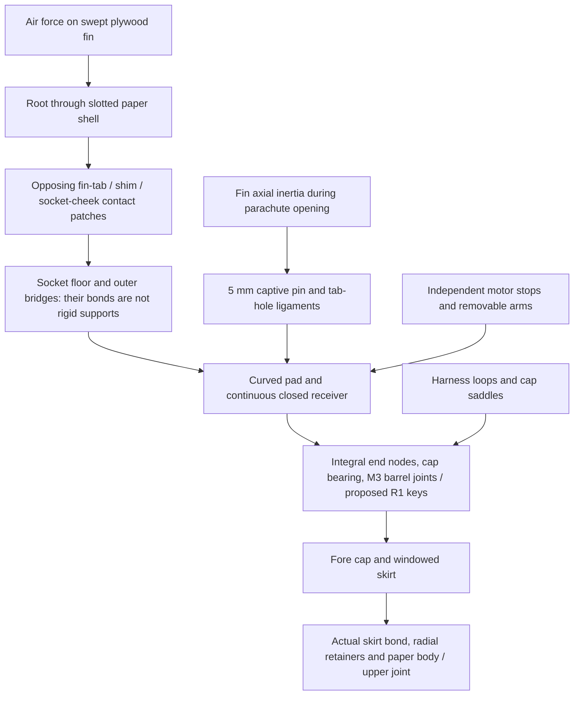

# C1 installed-fin preflight — R1 stopped before detailed analysis

**Decision:** keep C1 as the selected preliminary G80 direction. Do not adopt
the screened R1 reinforcement. R1 adds **70.111g**, misses the separate
conditional15.5m/s planning budget and gives **0.991984cal** in the additional
20g/motor-balance case, below the unchanged1.0 requirement. Its socket bridge
bond also fails the existing provisional hot shear screen. No installed-fin,
body, thermal or flutter requirement is accepted by this packet.

One next construction correction is a **lightweight sandwich fin with a dense,
positively captured root insert**: separated strong faces provide bending
stiffness without keeping the entire heavy plywood panel; an integral/captured
socket closure must replace the overloaded narrow bonded bridge. This is a
bounded next preflight direction, not an executed second reinforcement, a CAD
release or permission to weaken the root. Its complete replacement ledger must
include the insert, face bonds, closures, end connections and finish. No load,
material limit, growth allowance or launch baseline has changed.

## Exact identity and scope

The [source lock](wo03-c1-attachment-source-lock.md) and
[machine-readable ledger](../configs/studies/wo03-c1-attachment-source-lock.json)
freeze the selected C1 specification, 50 retained S3 rows, eight removed rows,
34 new C1 rows and 44 selected-case changes. Starting nominal mass is
1079.806750977g plus **separate50g at1227mm** =1129.806750977g. The other case
adds20g at1227mm **beyond** those50g and shifts the unchanged128.2g motor's
assumed balance point12.8mm aft. The latter is exploratory, not a supplier
tolerance. No ballast/equipment relocation is selected.

The [new specification](../configs/studies/wo03-c1-fin-attachment.yaml),
[as-run record](../runs/wo03-c1-fin-attachment-20261102-v1/record.json) and
[connection audit](../runs/wo03-c1-fin-attachment-20261102-v1/connection-audit.json)
are one separate preliminary identity. Executed input/script copies and SHA-256
identities are saved beside them. C1/R1 have no reconciled CAD revision yet;
the current active vehicle and archived preview are unchanged. Earlier STEP,
panel, thermal, flight and full-inertia results cannot fill those gaps.

## Real load path and connections

Axial stations increase aft from the nose; dimensions below are millimetres.
Radial distance is from the rocket centreline. A socket is the channel capturing
the fin root. Peeling pulls a bond apart; shear slides its faces past each other.

The paper slot is not credited as an infinitely stiff clamp. Tangential5mm fin
pins at1180mm/R24.3 stop axial loss; their axes are parallel to fin-normal force,
so they do not replace the opposing side-contact bending path. The12mm-deep,
100mm-long socket contacts lie atR18.3–30.3; the external root is atR33.
The closed receiver spans1010–1211.8, outsideR32. Its cap faces meet the ends;
six integral nodes carry the retained27/19.5mm finished M3 screws and6mm barrel
nuts. Fin force still has to pass through the actual node/cap/skirt/body joints.

R1 keeps every retained function and adds carbon faces over the **full panel
and14.7mm tab**,3mm cheeks instead of2mm,1mm receiver instead of0.8mm, widened
floors/pads/bridges and six12×6×6 antirotation keys atR27. Each key has6mm end
engagement and0.02mm per-flank clearance; attachment/pocket ligaments remain
unqualified. Existing cap hardware is retained, not assumed to disappear.
The proposed keys address screw-clearance rotation; they do not qualify cap
pull-off or the recovery load path.

## Applicable loads and attachment results

The retained starting case is40kPa dynamic pressure (air-speed loading) and5°
angle of attack (angle between flight direction and the rocket). The existing
finite-aspect-ratio formula on C1's90span/120root/60tip/40sweep fins gives
**73.586N and2.94345N·m per fin before DF3**; strength demands are
**220.759N and8.83035N·m after DF3 once**. Service movement uses unfactored
loads. This is the required starting screen, not a newly validated C1 flight
maximum. No old isolated-fin pass is transferred.

Transporting that force8.7mm inward to the socket's contact centre raises its
moment to**10.75095N·m**; ignoring this lever would understate socket loading.
Two opposing half-depth600mm² patches carry1902.204N and1681.445N. Their force
and moment residuals are below6e−14N and1e−12N·m. This is equilibrium, not an
accurate local contact-pressure distribution.

| Item | C1 result | R1 result | Criterion / evidence boundary |
| --- | ---: | ---: | --- |
| Hot/weak-direction panel service deflection, ideal root |2.855mm |0.812mm |≤1mm **total installed**; strip bending only, before shear/root/body motion |
| Factored plywood panel-root stress |12.062MPa |3.431MPa |Estimated hot5MPa: ratios0.415 /1.457; R1 carbon stress71.901MPa uses an unqualified100MPa screen |
| Mean opposing socket pressure |3.170 /2.802MPa |Same |Peak crushing and hot directional bearing allowables unavailable |
| Cheek bending with ideal simple supports at both edges |48.150MPa |21.400MPa |Estimated hot25MPa: ratios0.519 /1.168; ideal supports are not the installed assembly |
| Cheek bending if outer support is lost |256.798MPa |114.132MPa |Both exceed25MPa; the outer bridge is structurally essential |
| Outer bridge reaction / minimal mean bond shear |1426.653N /7.133MPa |1426.653N /4.756MPa |Existing hot1MPa estimated shear screen: both fail; peel/edge stress unavailable |
| Panel + socket play + ideal receiver service motion |3.153mm |1.018mm |Both exceed1mm even before unknown local support flexibility |
| R1 with finite end-contact sensitivity |— |1.133–1.499mm |Effective contact modulus0.1–1GPa is an explicitly unvalidated sensitivity; no rigid-ground pass |

The receiver-only motion initially used the external-root torque. The preserved
v1 record is corrected in the read-only connection audit to use the full socket
torque; only that proxy and its aggregate are superseded. No guide or native
calculation was repeated. The reported table uses the correction.

For a single-fin envelope, ideal end reactions are78.545/142.213N transverse
and3.825/6.926N·m torque fore/aft. An end joint carrying its entire torque through
one M3 screw needs159.382/288.574N tangential force and22.55/40.82MPa pin shear;
barrel mean bearing is4.23/7.66MPa, two-ligament shear1.17/4.69MPa. These are
**demands**, not passes from a generic G11 tensile property. R1 one-key demands
are141.673/256.511N, or3.94/7.13MPa across36mm². Unequal contact, local cap
bending, key/pocket tear-out and real fastener grades remain open.

The uncut receiver's ideal hot torsion stiffness is an upper bound. Putting
finite end contacts in series reduces it; neither this bound nor coincident
cap datums establish installed strength. The original3.4mm bore/3mm screw
permits about0.823mm fin-tip movement from end clearance alone. R1 positive keys
reduce that particular freeplay sensitivity, while their own0.02mm per-flank
gap still contributes0.073mm. Actual body bending/socket indentation add motion.

The fin's severe recovery inertia rises from98.05N to115.46N with its faces.
The5mm double-shear pin, tab bearing and axial tear-out demands are saved;
tab bearing3.11→3.67MPa and tear-out1.06→1.25MPa remain unqualified without hot
directional data. Fore-skirt mean aero shear31.1kPa torsional/20.4kPa transverse
does not settle peel, local paper crushing, radial-retainer strength or upper-joint
flexibility. Full recovery in a single M3 cap joint exceeds the provisional
200MPa tensile screen. Equal sharing or an all-compression reaction is unproven.

Unslotted isotropic-cylinder buckling sensitivities give15.10–49.06MPa for C1
and18.93–61.52MPa for R1 after illustrative0.2–0.65 reductions. C1 full recovery
mean is15.01–15.28MPa; R1 is12.79–13.01MPa, doubling if only half the section
is effective. These are not justified lower bounds for a slotted glass laminate.
[NASA's composite-cylinder bulletin](https://ntrs.nasa.gov/citations/20240000391)
warns against treating0.65 as universal. Actual imperfections, ports, laminate,
end flexibility and local contact modes remain installed buckling requirements.

Three identical120° fins in the linear steady-angle model do not experience
three same-sign maximum roll moments. The single-fin envelope is local;
asymmetric gust/roll, axial drag, acceleration and recovery combinations still
require the complete geometry and trajectory. No fictitious simultaneous load
combination is used to claim failure or success.

## Complete coupled budget

| Added R1 item, all estimates | Added mass |
| --- | ---: |
| Six carbon panel/tab faces |20.097g |
| Separate panel/tab face adhesive |3.158g |
| Additional sealing/finish |1.500g |
| Six cheek thickness increments |13.320g |
| Wider floors / pads / bridges |5.922g |
| Receiver wall increment |14.590g |
| Six keys |4.795g |
| Additional key retention/bond allocation |2.000g |
| Maximum selectable root-shim stock |4.729g |
| **Added total; no removal credits** |**70.111g** |

These additions are above C1's complete ledger, including existing socket
adhesive/process8g, end nodes25g, motor carriers12g, fasteners, loops, retained
shims,6g heat protection, service hardware, recovery electronics/power, harness,
finish and5g guide conversion reserve. Allocations and supplier typical areal
weights are not measured installed masses or upper uncertainty bounds.

| Case |Nominal subtotal / separate allowance / total |Balance point |Loaded / burnout stability |Severe opening demand |
| --- | ---: | ---: | ---: | ---: |
| C1 |1079.807 +50 =1129.807g |879.798mm |1.319 /1.546cal |2384.141N |
| C1 + additional20g and motor-CG probe |1099.807 +50 =1149.807g |887.264mm |1.206 /1.433cal |2426.345N |
| R1 |1149.918 +50 =1199.918g |894.561mm |1.095 /1.296cal |2532.090N |
| R1 + additional20g and motor-CG probe |1169.918 +50 =1219.918g |901.357mm |**0.991984 fail** /1.194cal |2574.295N |

The aerodynamic-force location remains966.828mm in the unchanged planform
model;1cal requires balance≤900.828mm. Thickness/root aerodynamics are unvalidated.
Opening demand is recalculated at every complete mass with unchanged
`3*m*(20.4²/(2*0.3)+9.80665)`; it is an energy-equivalent mean screen, not a
measured peak. Full intrinsic inertia is **unavailable**. The added items'
axial point contribution about the new balance is0.004035/0.003811kg·m² for
R1 nominal/adverse; it omits retained/radial/intrinsic terms and is not a full
vehicle tensor.

| Case |1.5m usable baseline |1.8m hypothetical |1.971m illustrative |Formal15 headroom at1.971m |Separate15.5 planning headroom at1.971m |
| --- | ---: | ---: | ---: | ---: | ---: |
| C1 |13.663m/s |14.975m/s |15.676m/s |90.147g |22.509g |
| C1 adverse |13.526m/s |14.826m/s |15.519m/s |70.147g |2.509g |
| R1 |13.198m/s |14.467m/s |15.144m/s |20.036g |−47.602g |
| R1 adverse |13.072m/s |14.329m/s |15.000251870m/s |0.035501g |−67.602g |

R1 adverse is a conditional numerical formal-speed pass of only0.000251870m/s,
not useful margin; it separately fails stability and the planning target.
No rounded result closes a failure. Headroom uses saved lower-pass mass-root
endpoints1219.953266g /1152.315474g, not new universal mass limits. Six new guide
probes retain thrust×0.85,Cd0.8,0.5N friction,constant loaded mass and full50g.
Original C1 probes are reused. **No longer rail or usable travel is confirmed.**
The1.5m baseline stays. The [Nov2 official-source recheck](wo03-launch-evidence-20261102.md)
does not close ROC/MDARS equipment/button/support/operating acceptance.

## Manufacturing, heat, service and dynamics

The exact [0.25mm carbon product](https://www.easycomposites.co.uk/double-sided-high-strength-carbon-fibre-sheet)
lists actual0.22±0.10mm and0.35kg/m²,0/90 fibres and typical50.1GPa tensile
modulus. The other supplier's quasi-isotropic1–4mm datasheet is not this material.
R1 uses40/20GPa cold/hot estimates and a separate100MPa screening strength,
not supplier hot bending/compression/bond allowables. Its45°C substrate assumption
must itself pass the unchanged thermal matrix. The G11 tube's
[typical axial data](https://acculam.com/images/ecommerce/Product/Files/AcculamG11NonFRTube.pdf)
do not supply socket-bearing, interlaminar, peel or slotted hot-body allowables.

At thickness extremes, R1 finished tab is6.59–7.19mm; socket7.20–7.30 gives
0.01–0.71mm total cold gap, requiring selected shims. This barely positive
minimum is not a hot-fit pass. Paper slot7.45±0.10 is a preliminary widened
interface. Carbon/bond expansion, shim retention, alignment, remaining shell
ligaments and root/gusset interference are unverified. No material-removal
credit is taken before geometry reconciliation.

Outside receiver radius stays32, preserving only the source conditional outer
gap sensitivity0.108mm against0.1mm. Its inside radius shrinks31.2→31.0;
motor/support/baffle/strap access must be checked again. Source axial capture
travel2.7mm after manufacturing loss exceeds the saved2.0352mm expansion
sensitivity by0.6648mm; exact motor/nozzle/clip/hot retention is still unresolved.
Wider sockets and end keys need actual strap-slot, cotter, tool and insertion
paths. Nominal arming/electronics/parachute locations and independent recovery
power are preserved; packing/extraction and removal are not newly demonstrated.

The wall increment increases the simple continuous axial conduction area about
25%; wider bridges, conductive faces, new glue and end keys add/change heat
paths. There is **no new temperature prediction** and no permission to omit real
openings or treat glue-filled areas as simultaneous full-area air paths. Keep
all required burn/soak cases, including300°C case + contaminated foil +35°C
ambient, and the45°C substrate screen. Earlier failed baffle results retain
their identities/failures, never an accepted C1/R1 overlay.

Changed90mm span, sweep, roots, thin receiver and carbon faces change bending,
torsion, mass distribution and damping. Installed flutter—airflow-driven growing
vibration—remains unavailable. Neither a clamped strip nor the old isolated
NACA/panel result establishes installed flutter speed. Modal/root-stiffness and
applicable aerodynamic-speed uncertainty must be resolved after a viable
construction preflight, followed by owner modal/hot-load measurements later.

## Numerical evidence, closure and next stop

One CPU packet used0.400CPU /0.478s elapsed against20CPU/30s. No CAD/native
stress/thermal/free-flight solver was run. The rectangular beam's independent
known answer is0.694444444mm; final error0.0000391%. C1 and R1 strip deflections
change0.0005064% over the final401→1601-point refinement (three levels101/401/1601).
This is hand-formula integration accuracy, **not FE mesh convergence or model
accuracy**. The swept orthotropic plate, elastic contacts, joints, hot properties
and installed modes still need the work order's verified/refined analysis.

| Issue | Correction / criterion | New result and evidence | Remaining design / later physical verification |
| --- | --- | --- | --- |
| C1 sources could drift | Frozen hashes and complete ledger |Source lock complete; executed vs formatted code identities preserved |Measured BOM, supplier revisions and reconciled CAD still required |
| Root-to-socket lever omitted in a simple proxy |Transfer force and moment consistently |10.751N·m and balanced opposing patches; connection audit |Local contact/peak pressure and hot bearing coupons |
| Panel/root and bridge too compliant/weak |One counted R1 face/socket/receiver/key package |Hot panel improves; total motion, bridge shear, planning mass and adverse stability fail |Stop R1 before detailed analysis; one sandwich/root-closure preflight next |
| End/body connections unqualified |Explicit M3/barrel/key/skirt demands and finite supports |Demands recorded; no rigid-support or equal-sharing acceptance |Actual joint elasticity/peel/tear-out/cap/body solve, then owner proof/hot tests |
| Coupled allowance/departure/recovery hidden |Full50g and separate additional20g |All four complete cases tabulated; conditional only |Exact guide/buttons/club and motor source; full inertia and affected flight checks only after viable integration |
| Thermal, fit, packing and installed flutter absent |No incompatible result transfer |Unavailable, not zero/pass; no new CAD/analysis overlay |Complete viable geometry, qualified thermal route, installed modes, service and owner extraction/temperature tests |

Next bounded deliverable: one replacement sandwich-fin/dense-root/integral-socket
preflight retaining C1 external planform and every receiver/recovery/motor
function. It must fit the **complete** conditional mass/balance budget with
useful margin and show finite root/end force transfer. Stop before detailed
geometry if its complete ledger, hot strength,1mm motion or1cal adverse screen
fails. Equipment remains a separate confirmation dependency, not a reason to
raise budgets silently. WO-03 remains open; G54 and G12/PID-to-RL evidence and
all physical, purchase, paid-compute, WO-10 and flight-release gates remain.
