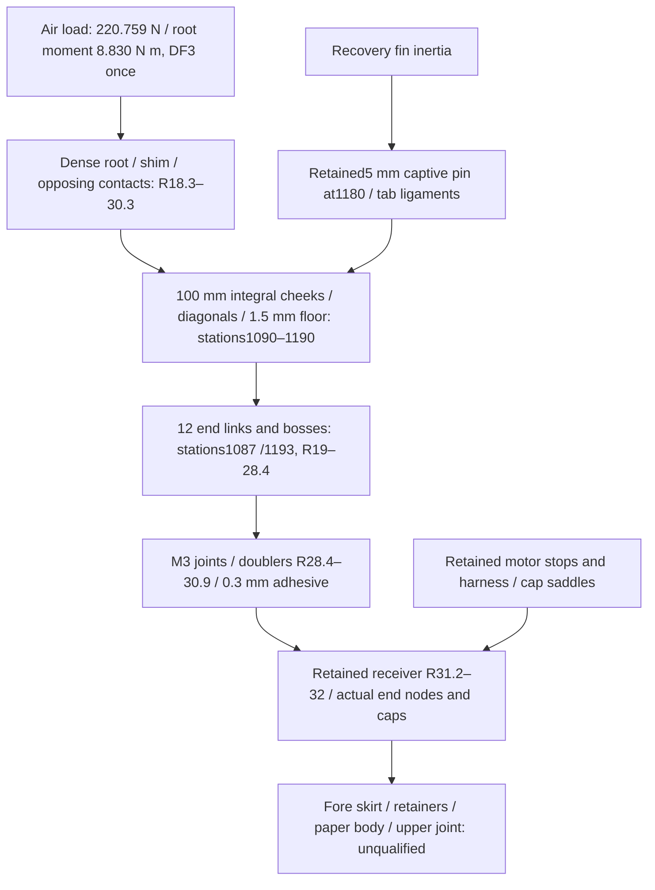

# C2 sandwich fin / integral socket — rejected before detailed analysis

**Decision:** do not adopt C2 or start detailed CAD/FEA. The receiver-pad bond
demands **3.828 MPa against the estimated hot 1 MPa screen**, the floor demands
**58.501 MPa against 25 MPa**, and the aggregate service-motion proxy is
**2.328 mm against 1 mm**. Nominal harness/link polygons overlap. Both complete
mass cases miss separate conditional 15.5 m/s planning. The isolated sandwich
panel's **0.545 mm** movement is promising preliminary evidence only.

## Identity and bounded execution

The [C2 specification](../configs/studies/wo03-c2-sandwich-socket.yaml),
[v2 record](../runs/wo03-c2-sandwich-socket-20261102-v2/record.json), executed
input/script copies and input SHA-256 manifest identify one construction
candidate. [V1](../runs/wo03-c2-sandwich-socket-20261102-v1/failure.json) stopped
on 72 stale-CAD-property validation errors in its input context; that failure
is preserved. V2 uses the frozen C1 checkout context without a geometry change.
Its stricter **10 CPU / 15 wall seconds** cap used **0.342 / 0.383 seconds**,
one thread, below the specification's outer 20/30-second budget. No native
analysis, CAD, thermal or flight run occurred. C1/R1 records remain unchanged;
this is neither a new active configuration nor a reconciled C2 CAD revision.

## Dimensioned force path

Stations increase aft from the nose; radii are from the rocket axis, all in mm.
The unchanged external fin is span/root/tip/sweep **90/120/60/40** at station
1080. Its 8 mm foam core meets a 10 mm dense root band and 100 × 14.7 mm
through-body tab. Continuous carbon faces connect panel and tab.

| Connection | Recorded demand / remaining boundary |
| --- | --- |
| Root → socket centre R24.3 | Transport over 8.7 mm gives **10.75095 N·m**; opposing 600 mm² patches carry **1902.204 / 1681.445 N** |
| Socket → receiver axis | **16.11538 N·m**, distinct from root and socket moments; no second DF3 |
| Integral cheek / diagonal / floor | Factored **24.566 / 21.741 / 58.501 MPa**; floor fails estimated 25 MPa; first two proxies do not qualify joints |
| One receiver joint carries full single-fin torque | **516.519 N** tangential; M3 shear **73.072 MPa**, boss bearing/tear-out **14.348 /16.555 MPa**; local capacities unavailable |
| Doubler → thin receiver | Net bond **134.921 mm²**, mean shear **3.828 MPa**; screen ratio **0.261**, fails; peel unqualified |
| Receiver → caps / skirt / body | Retained finite connection path, not fixed ground; no equal-sharing credit or installed acceptance |

## Complete replacement ledger

These are gross estimated allocations, not measured masses. Every signed row
and axial station is retained in the record; no extra cutout/overlap credit is
taken beyond the explicit boss/link overlap. Existing motor, receiver/end nodes,
recovery power/canopy/harness/anchors, heat protection and original 8 g fin-bond
potting reserve remain counted.

| Replaced or added functions | Signed mass, g |
| --- | ---: |
| Remove full C1 panels, original CAD fin residual and deeper tabs once | −139.387697 |
| Remove six old cheeks / three floors | −26.640000 /−12.154500 |
| Remove six outer bridges / three pads | −4.440000 /−5.469525 |
| Remove C1 socket process/hardware allocation | −8.000000 |
| **Gross removed** | **−196.091722** |
| Dense root bands / complete through-body tabs | +20.020000 /+25.225200 |
| PVC core / panel and tab carbon faces | +12.480000 /+42.490800 |
| Panel/tab face bonds / root-core butt bonds / edge finish | +3.158100 /+0.299200 /+2.000000 |
| Three integral floors / six cheeks / six diagonal closures | +16.650000 /+39.960000 /+33.492583 |
| Twelve end links / boss increments / receiver doublers | +3.756240 /+9.590400 /+7.992000 |
| Doubler bonds / twelve complete finished M3 sets | +0.534286 /+22.775609 |
| Locking/service reserve / full selected shim stock / pin sleeves | +3.000000 /+6.127200 /+0.469591 |
| **Gross added / net change** | **+250.021210 /+53.929488** |

## Coupled mass, balance, launch and recovery

CP remains **966.827598 mm**. Both cases retain full separate **50 g at1227 mm**;
the adverse case adds another **20 g at1227 mm** and the existing motor-CG
probe **12.8 mm aft**, not a supplier tolerance. Full intrinsic inertia is
**unavailable**; signed axial ledger point contributions are not vehicle tensors.

| Complete case | Nominal subtotal + separate50 / total, g | Loaded / burnout CG, mm | Loaded / burnout margin, cal | Guide speed1.5 /1.8 /1.971 m, m/s | Severe recovery mean, N |
| --- | --- | --- | --- | --- | ---: |
| C2 nominal |1133.736 +50 /1183.736 |891.673 /878.053 |1.138713 /1.345066 |13.301772 /14.580217 /15.262662 |2497.944 |
| C2 +20g / motor-CG probe |1153.736 +50 /1203.736 |898.607 /884.905 |1.033642 /1.241246 |13.173560 /14.440104 /15.116222 |2540.148 |

At illustrative **1.971 m**, formal15 headroom is **36.217 /16.217 g**, but
separate15.5 planning headroom is **−31.421 /−51.421 g**. The 1.5 m baseline
fails formal15; 1.8 m also fails. Guide assumptions remain thrust×0.85,
constant full loaded mass, estimated drag/friction and vertical travel. No
equipment, launch date, usable travel or button/support acceptance is confirmed;
**the resolved1.5 m reference is unchanged**. Recovery remains the unchanged
20.4 m/s, 0.3 m, DF3 energy-equivalent mean screen, not measured peak opening.

## Numerical evidence and open construction limits

The recorded101/401/1601-point integration changes panel/root proxies by
at most **0.000194%** over the final step; agreement with the existing96-point
method is **0.0000129%**. This checks formula integration, not FE convergence
or installed model validity. Cold root/channel ranges are **8.63–9.33 /
9.45–9.55 mm**: minimum gap0.120 mm requires selected shims, not a hot-fit pass.
The actual nominal2D harness/link minimum is **0 mm**, becoming **−0.7 mm**
after motion/manufacturing deductions, against required0.1 mm. Finished-screw
length17.4 mm exceeds the17.0 mm grip/nut/protrusion stack; motor-tip proxy
gap0.540 mm does not demonstrate tool, pin, bolt-sweep, motor-removal, packing,
extraction or arming access.

The [configured foam datasheet](https://media.easycomposites.co.uk/datasheets/EC-TDS-Easy-Cell-75-Closed-Cell-PVC-Foam.pdf)
provides typical material information, used with explicit halved hot estimates.
The [configured carbon datasheet](https://media.easycomposites.co.uk/datasheets/EC-TDS-Double-Sided-High-Strength-Carbon-Sheet.pdf)
identifies the0.5 mm product's actual0.44±0.10 mm and typical0.74 kg/m² inputs.
Neither supplies qualified installed hot bending, compression/wrinkling, peel
or bond allowables. Root face-bond mean0.936 MPa alone cannot clear peel.
The required thermal matrix,300°C case/contaminated foil/35°C ambient, burn
plus soak and45°C substrate screen remain; new conduction/contact paths have
no temperature result. Sandwich/frame torsion, damping, finite ends and actual
speed-domain installed flutter remain unavailable.

Receiver-axis rotation converts to fin-tip movement at **123 mm**, not98.7 mm.
The separately recorded datum correction gives C1 **3.1982 mm** and R1
**1.0543 mm** panel/play/ideal-receiver proxies; both still fail1 mm. Earlier
R1 **1.039 mm** remains a superseded recorded proxy, without rewriting its run.

**No physical engineering requirement closes.** Stop C2 here. A necessary
interface change is continuous moment transfer into a structural receiver/end
joint path compatible with the harness; another local glued pad cannot resolve
this result. No next candidate is executed or automatically admitted. Later
owner hot-load, modal, recovery and service tests cannot substitute for fixing
the present analytical failures. WO-03 stays open; G54, G12/PID-to-RL and all
purchase, physical, paid-run, WO-10 and flight-release gates remain separate.
