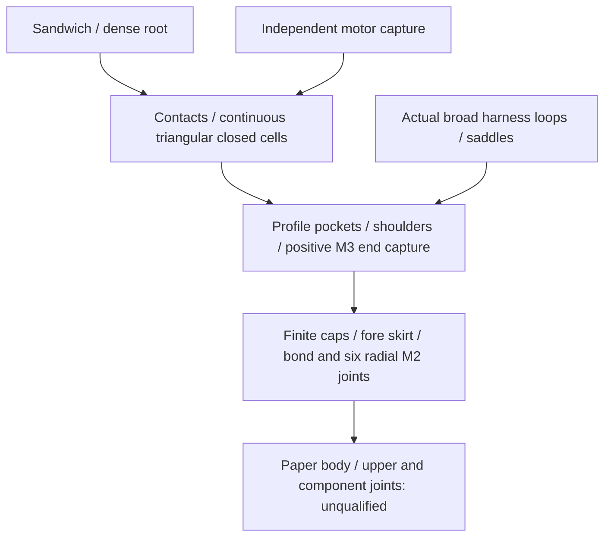

# C3 continuous triangular receiver — frozen connection notes

**One proposed construction, not admission:** extend C2's integral triangular
socket into three continuous receiver channels with positively captured ends.
Keep its sandwich fin/dense root. The central aft node conflicts with the
independently removable motor arms; retain that conflict as an admission stop,
without an offset-node variant. This note performs no calculation, CAD, FEA,
thermal or flight run. The primary owns the one bounded screening packet.

## Sources and proposed geometry

Use the saved [S3 configuration](../configs/studies/wo03-g80-connected-receiver.yaml),
[C1 configuration](../configs/studies/wo03-g80-mass-balance-revision.yaml),
[C1 source identity](wo03-c1-attachment-source-lock.md),
[C2 configuration](../configs/studies/wo03-c2-sandwich-socket.yaml) and
[C2 rejection record](../runs/wo03-c2-sandwich-socket-20261102-v2/record.json).
C2's isolated panel0.545 mm is not an installed pass; its failed root/floor/bond
results remain historical, not transferred capacity. No new supplier allowance
or live-source verification is introduced.

Dimensions below are mm: local radial **r**, tangential **t**, axial **z** aft
from the nose. Three fin/channel axes remain0/120/240°.

| Interface | Frozen proposed construction |
| --- | --- |
| Continuous channel | Extend the C2 section through **z1010–1211.8**. Integral central tenons extend3 mm into each cap; this stock is charged. Outer corners are trimmed to radius31.0 to clear the retained R31.2 receiver; no trimming mass credit. |
| Contact and side cells | Channel9.50±0.05; opposing3±0.2 cheeks at **r18.3–30.3**; diagonal closures2.4±0.2 from **(r18.3,t±10)** to **(r30.3,t±6.25)**, extended continuously. Retain central fin opening and C2's1.5-thick,20-wide base at r16.8–18.3. |
| Fin retention | Dense tab1090–1190 and retained5 mm captive pin at1180. The pin retains axially, without fin-normal bending credit. |
| Cap capture | Central tenons r20–28, t±3 enter8.04 radial ×6.04 tangential pockets3 deep in existing6 mm caps: fore1007–1010, aft1211.8–1214.8. Flanks carry tangential/radial contact; shoulders carry compression. Six axialM3 sets retain pullout. Caps/ligaments remain flexible and unqualified. |
| Filled end-node stock | Fill the central channel cavity **r18.3–30.3, t±4.75** through fore1010–1042 (32 long) and aft1197.8–1211.8 (14 long). Existing floor/cheek/diagonal stock is already counted. The separate3 mm tenons contain8×6 mm sections; no cavity-fill/profile overlap credit is needed. |
| Node hardware | Central **r24,t0**; barrel centres **z1024/1203.8**,6×6 barrel in6.2 transverse bore;3.4 axial bore. Retain27/19.5 finished-screw hypotheses. Full thread, washer, tool, ligament and local-contact geometry remains required. |

Continuity removes the local glued-pad mechanism only as **design intent**.
It does not qualify the thin base, contact pressures, distorted cross-section,
end reactions or installed movement.

## Geometric admission stops

The solid central aft node occupies the retained motor-arm sweep:
**1203–1207**, plus source3.2 mm travel, **r12–30.3**,6.6 tangential width.
The barrel centre1203.8/r24/t0 is inside that region. Removing material for the
arm cannot simultaneously leave the specified solid barrel support. Stop at
this physical joint failure; do not move the node, narrow the arm or disturb
recovery to manufacture a pass.

Removing C2's links removes its demonstrated link collision, but does not
prove harness clearance. Preserve all six actual legs at saddle axes
**60/180/300°**, centred r24/t±9 in their own frames. Each leg is **12.7 radial
×0.55 tangential**, occupying r17.65–30.35 in that frame; it is not a thin radial
line. Retain13.0×1.4 cap slots. The primary must compare complete diagonal,
base, node and hardware polygons with these broad legs, deducting0.5 movement
and0.2 manufacturing while retaining0.1 clearance. No distance is calculated
here. No routing, preload or equal-sharing assumption is changed.

## Global torsion and actual body support

The59.299 g original receiver stays counted for its body-support function; no
removal credit is earned. Fin slots and unqualified contacts prevent treating
it as an intact torque tube. The small channel cells and finite cap restraint
need their own torsion/warping model; that calculation stops at the geometric
admission failure. No stiffness estimate is promoted to installed evidence.
Do not assume equal channel sharing, infinitely restrained warping or use
local stress to settle global twist. No idealized torsion formula establishes a qualified bound for drilled
anisotropic material and flexible contact.

The actual body path remains the30 mm skirt974–1004, windows995–1004,
0.3–0.7 radial bond and six radialM2 retainers/washer footprints. Paper cut
strength, peel, crushing and upper/component joints remain open. No fixed
body support or all-compression recovery reaction is established.

## Complete accounting and bounded stop

Trace removal against one frozen baseline: retain C1's closed receiver for body support; replace its local socket parts
and process allocation once. Remove25 g end nodes and12 g
motor carriers only when their actual barrel/contact and three5 mm key-pin
support functions are integrated and charged. Replace C2 cartridge/link/boss/
doubler/attachment rows if using its ledger; do not duplicate removal credits.
Charge full continuous channels, cavity fills, tenons, backstops, caps without pocket credit,
shims, finish, locks, protection and service details. Count overlap explicitly:
subtract proven duplicate stock or conservatively charge it as overlap reserve.

Preserve motor keys, mica, independent arm capture/travel, harness, recovery
power/canopy/anchors, body support, heat occupancy and guide reserve. Full
separate50 g/additional20 g remain; C1 conditional nominal22.509 g versus
adverse2.509 g planning headroom is not universal capacity. Equipment remains
unconfirmed and the1.5 m baseline unchanged.

The primary's single10-CPU/15-wall-second packet may screen complete mass/CG,
guide/recovery, nominal strap distance and axial node/arm overlap. Physical
failure stops detailed stress/refinement. Hot bond1 MPa, G11 bending25 MPa,
45°C substrate, full required burn/soak matrix,1 mm movement and1 cal adverse
stability remain unchanged; full inertia, installed flutter and service remain
unavailable. **Next necessary interface change:** separate independent motor
retention's swept volume from the continuous rail end node while preserving
closed-section torsion transfer. No next variant or requirement closure follows from this note; owner-performed physical gates remain intact.
