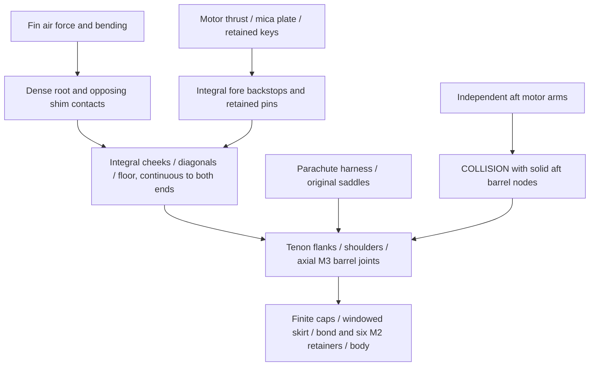

# C3 continuous connection: not admitted

**Decision:** stop this one construction before detailed CAD or finite-element
analysis. Its aft solid barrel-nut node and independent motor-retention arm
occupy the same volume. The complete charged construction is **105.504 g heavier
than C1**, and fails guide departure even on the illustrative longer guide.
The adverse balance case also fails one calibre. C1 remains preliminary;
neither the active vehicle nor the launch baseline changes.

The [specification](../configs/studies/wo03-c3-continuous-connection.yaml),
[connection notes](wo03-c3-connection-notes.md) and
[executed record](../runs/wo03-c3-continuous-connection-20261102-v1/record.json)
freeze one arrangement. The one-CPU packet used **0.353 CPU /0.421 wall seconds**
within10/15-second limits. It reuses saved C2 **fin-construction masses** and the
existing conservative guide calculation; it does not rerun C2, CAD, FEA, thermal
or free flight. Archived executed inputs/code preserve the actual run. The
maintained script subsequently received only a lint conversion of literal
`dict(a=x)` constructors; an AST comparison verifies equivalence without a rerun.

## What actually connects

All dimensions are mm. Station increases aft from the nose, with radial and
tangential coordinates local to each0/120/240-degree fin axis.

Three integral G11 cartridges extend1010–1211.8. Each has a20-wide,
1.5-thick base at radius16.8–18.3, two3-thick cheeks at18.3–30.3 and two
2.4-thick diagonal walls. These are machined continuous material, not separate
parts joined by an unverified butt bond. The9.5-wide channel receives the saved
sandwich fin's dense root and selected shims. The original5 mm pin retains it
against extraction; the pin is not credited as a fin-normal bending support.

Integral central fills at1010–1042 and1197.8–1211.8 support the six existing
axial M3/barrel-nut sets. Each fill occupies radius18.3–30.3, tangential±4.75;
barrel axes are radius24/tangent0 at1024/1203.8. Integral8-radial×6-tangential
tenons extend3 into pockets in the existing6-thick caps. Pocket flanks and
shoulders carry direct contact; screws retain separation. Their finite3 mm
remaining cap floors, ligaments and load sharing are **not** rigid supports.
Outer corners are trimmed to radius31.0; no material-removal mass credit is
taken. The original59.299 g receiver remains counted for body support: its
function has not been eliminated or qualified by this proposal.

The body connection still includes the30 mm skirt,0.3–0.7 radial bond with
75–100% coverage and six radial M2 retainers. Adhesive shear, peel, paper
crushing, upper joints and component branches remain unqualified. No perfectly
rigid support, friction, equal force sharing or recovery-strap motor retention
is substituted for those connections.

## Complete stock accounting

| Removed/replacement function | Signed mass, g |
| --- | ---: |
| Old full fin construction | −139.388 |
| Old local cheeks/floors/bridges/pads and socket process allocation | −56.704 |
| Old six barrel nodes and three front motor carriers | −37.000 |
| **Gross removed** | **−233.092** |
| Saved complete sandwich panels, dense roots, skins, glue and finish | +105.673 |
| Selected full root shims and pin sleeves | +6.597 |
| Continuous floors / cheeks / diagonals | +33.600 /80.639 /67.588 |
| Integral central end-node cavity fills | +29.104 |
| Six cap tenons / fore motor backstops | +1.598 /3.796 |
| New motor-key shim allocation / process, locks and service reserve | +2.000 /8.000 |
| **Gross added / net change** | **+338.596 /+105.504** |

The record contains every signed row and station. Gross profile overlaps and
unmachined holes/corner/pocket volumes earn no extra credit. Existing receiver,
caps, six complete end-fastener sets, all original motor keys/pins/mica/keepers,
independent recovery/controller/power, straps, canopy and original8 g fin-potting
reserve remain counted. These are estimated allocations, not measured weights.

## Coupled results

CP, the effective aerodynamic-force point, remains966.827598 mm because the
external fin planform is unchanged. The nominal and adverse cases below each
include the full separate50 g at1227. The adverse case adds a further20 g there
and the saved12.8 mm motor-CG probe; the probe is not a supplier tolerance.

| Case | Subtotal + separate allowance / total, g | Loaded / burnout balance point, mm | Loaded / burnout margin, calibres | Guide speed1.5 /1.8 /1.971 m, m/s | Severe recovery mean, N |
| --- | --- | --- | --- | --- | ---: |
| Saved C1 nominal |1079.807 +50 /1129.807 |879.798 /864.795 |1.318632 /1.545947 |13.663463 /14.975462 /15.675768 |2384.141 |
| C3 nominal |1185.311 +50 /1235.311 |897.039 /884.304 |1.057407 /1.250353 |12.977247 /14.225541 /14.891938 |2606.778 |
| C3 +20g / motor-CG probe |1205.311 +50 /1255.311 |903.603 /890.755 |**0.957949 fails** /1.152610 |12.856520 /14.093597 /14.754038 |2648.982 |

On illustrative1.971 m usable travel, nominal/adverse mass headroom is
**−15.358 /−35.358 g** against formal15 m/s, and **−82.995 /−102.995 g**
against separate15.5 planning. All three sampled lengths fail formal departure.
No rail, usable travel, club or event is confirmed; the1.5 m reference remains.
The model retains thrust×0.85, constant full loaded mass and existing drag and
friction estimates. It is not a free-flight or wind-load validation.

Opening load retains20.4 m/s,0.3 m stopping distance and design factor3 applied
once to the energy-equivalent mean. These values are not a measured peak force.
Full intrinsic inertia is unavailable. The record's signed axial point-ledger
contributions are not a complete rotational-inertia tensor.

## Admission and remaining evidence

| Issue | Proposed correction / criterion | New result | Remaining verification |
| --- | --- | --- | --- |
| C2 overloaded local pad | Continuous integral channel to positive end pockets | Local pad removed from proposed primary path; **installed strength not established** | Contact/bearing/tear-out, finite cap/end/body path and hot load proof |
| Floor/root movement | Full-length integral section; service tip≤1 mm | **Unavailable; stopped before analysis**, not an inherited panel/root pass | Actual section distortion, torsion, finite supports and installed dynamics/flutter |
| Independent motor removal/retention | Aft solid node must clear arms and their travel | **Fails:4 axial×12 radial×6.6 tangential overlap**, already at nominal position | Resolve geometry before numerical or physical testing |
| Recovery route | Real broad12.7×0.55 legs, minus0.5 motion and0.2 manufacturing;≥0.1 gap | Nominal0.647848; bounded **−0.052152 mm**, short by0.152152 | Hardware/loop articulation, tolerances and actual installation/extraction |
| End joints | No equal-sharing assumption or generic G11 bearing allowable | One-full-fin-torque contact demand27.978 MPa; capacity unavailable. Whole-opening/one-M3 sensitivity374.750 MPa exceeds estimated200 MPa shank screen | Justified load sharing, actual threads/grade, pockets/ligaments/skirt compliance |
| Motor radial envelope / screw length |≥0.1 gap and complete stack | Radial proxy1.440; nominal travel residual0.6648. Minimum finished screws26.9/19.4 exceed counted24.5/18.5 stacks; **no service acceptance** | Actual purchased ends, retained travel, tools and full assembly paths |
| Mass/stability/departure | Full50 g;≥1 cal and formal15 m/s | **Fails coupled package** as above | A viable integrated revision before flight/reference checks |
| Thermal and materials | Unchanged required burn/soak matrix and45°C substrate | **Unavailable** for new continuous contacts;150°C G11 sensitivity is an assumed material state, not measured temperature | Qualified bounds/calculation and later instrumented/hot-joint tests |

**No installed engineering requirement closed.** This is a completed rejection
study. One specific next interface correction is to separate the aft motor's
removal/retention volume from the structural end-fastener node, while combining
body support and torsional load transfer so they do not remain duplicated mass.
It must first demonstrate a continuous clear harness corridor and a complete
weight ledger; moving the fastener into another unqualified local pad is not a
solution. No automatic new variant follows this packet. G80 remains first;
G54 and G12/PID-to-RL retain their own requirements and evidence. Expanded
WO-03 and all physical, purchase, paid-run, firmware-review and flight gates stay open.
