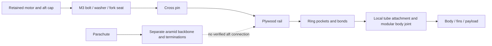
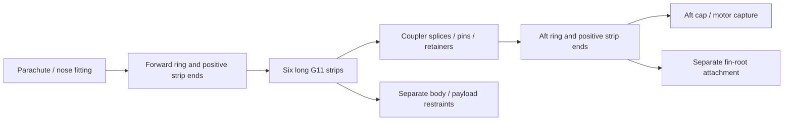

# G80 capture decision — stop both proposed envelopes before detailed analysis

**Decision: neither B nor C is credible in its specified envelope.** B moves
the weak connection into a thin plywood rail and its unverified ring/body
joints. C collides with the modular coupler; cutting its strips to fit fails
the current hot-section screen even with ideal load sharing. Do not run a new
CAD/FEA refinement campaign for either unchanged proposal. No installed strength,
thermal or complete-package acceptance requirement closes in this increment.
The useful closure is the bounded architecture comparison and the decision to
stop these two envelopes before expensive work.

| Screen | B: rail-aligned fork/pin capture | C: long continuous G11 frame |
| --- | --- | --- |
| Primary limiting result | 450 N on a 3 mm pin through the full 12 mm rail width demands 12.50 MPa bearing; generic plywood screen is 10 MPa. Bearing requires pin ≥3.75 mm while remaining section requires bore ≤3.25 mm under that same optimistic screen. | Proposed strips intersect the 30.5 mm-radius coupler bore. Fitting inside it leaves ≤59.665 mm² total section, demanding 29.87 MPa versus the estimated 25 MPa hot G11 screen, before holes/joints. |
| Additional fit/force concern | The defined 12 mm pin cannot span the 16.2 mm fork outside width, even before washers/retention. Eccentric rail force adds bending; rings and shell are not rigid grounds. | Strip/fin-channel clearance is nominally zero. End rings, module splices and body/fin capture are not complete verified joints. |
| Defined new stock only | 3.026 g: six lugs, three nominal G11 pin blanks, six washers | 198.640 g: six strips, two annular blanks, 12 splice plates, 24 nominal G11 pins and 48 washers |
| Bookkeeping mass including separate 50 g growth | 820.702 g with specified source removal credits; 847.608 g without credits | 1,016.315 g with credits; 1,043.221 g without credits |
| Complete installed mass / added installed mass | **Unavailable:** changed cap/guides, reinforcement, pin retention, shield and adhesive geometry are missing. Stock numbers are not bounds. | **Unavailable:** actual clipped geometry, end/body/fin capture, module connections, shields and adhesive are missing. Stock numbers are not bounds. |
| Disposition | Reject this unreinforced, short-pin envelope at preflight | Reject this coupler-intersecting, inadequately net-sectioned envelope at preflight |

G11 is glass-fibre/epoxy laminate; plywood and paper properties here remain
estimates. MPa means newtons per square millimetre. A bearing demand is the
contact force divided by the projected pin-contact area; it is not a measured
capacity. The generic 10/25 MPa screens are **not** mode-specific hot bearing,
pin, tensile or joint allowables. The conclusions reject these proposals under
the current evidence and screens, rather than predicting physical breakage.

## Scope, identity and loads

The physical source is the separate 72-part G80 retention candidate
`90b2a9ad780fc81d11171363432c46088531817ddb6570fe9f800429bde2bdfc`,
CAD revision `344f646f81e15d42ab54e7d996179581d638c6046bf1d006935b028709eca53f`.
Mass sensitivities start from the saved 73-part canopy +5 g as-run source,
whose metadata-corrected identity is
`6b0577cef1256065f27dc79bb494a89e6c1f0c90703c9815f47c7ae7910d1dc4`.
The as-run and metadata-corrected YAML identities differ; previous evidence
shows the simulator inputs are bitwise equal. This is **not** a new resolved
candidate, CAD snapshot or flight result. Active vehicle and preview are unchanged.

The existing retention preflight calls 150 N a reverse **service** force;
apply design factor 3 once, giving 450 N. One attachment taking that force is
an existing unequal-sharing sensitivity. The separate recovery demand is
**1,782.253 N already factored**; do not apply factor 3 again, combine it with
retention as a simultaneous load, or divide it among six members without a
demonstrated load-sharing model. The ambiguously named specification field
`reverse_retention_design_load_n: 150` remains an explicit dependency.

The previous 2 mm-web bond-only bridge remains adverse: two fixed-support
face-average shear bounds are **3.965/4.007 MPa after factor 3** versus the
estimated 1 MPa hot-bond screen. The 1.5 mm number is a calculation-grid setting,
not the bridge thickness. Passing force balance and reciprocal work establishes
consistency of the saved linear calculation, not installed strength. Original
CCX failures, coarse peaks and stopped refinements remain preserved.

## Complete intended load paths and weak connections

B replaces only the local bridge-to-rail route. It does **not** bypass the
paper body or complete recovery. Significant joints are cap/bolt bearing and
nut engagement; bolt/seat capture; pin/lug and pin/rail bearing; rail net
section and edge breakout; each rail/ring pocket; ring-to-shell load transfer;
and the modular body connection. Friction is credited as **zero** for primary
retention: no preload, contact pressure or friction coefficient is qualified.
Any lateral/sliding load must have positive stops or its own justified joint.
Remaining adhesive cannot be declared secondary until those joints actually
carry the force. Wood crushing, fork spreading, pin bending, hole tear-out,
rail bending, ring rotation, peel and paper crushing remain possible failures.

For the hypothetical **long-enough** 3 mm G11 pin only, ideal double shear is
31.83 MPa, ideal two-lug projected bearing is 37.50 MPa, and uniform rail
loading between the 14.2 mm lug-centre supports gives about 348 MPa pin bending.
Those simple pin values omit actual clearances/contact, laminate axes and pin
retention; they are not usable joint ratings. The specified 12 mm stock pin
does not engage both lugs at all. Outer washer faces require at least 18.2 mm
span, before any head/circlip/other retaining feature. No automatic longer-pin
or reinforced-rail variant was substituted.

C needs all those connections; an annular blank inside a tube is not an
attachment. The nominal inventory includes two end rings and 12 splice plates,
but their cut-outs, hole ligaments, actual module separation, fastener bearing,
ring bending, clamp/sliding reactions and shell attachments are undefined.
The intact long strips cannot pass through the current coupler. Ideal uniform
stress through a section trimmed to the coupler already fails the estimated
hot screen; no end-joint or perfectly rigid support can recover that section.
Unequal loading, holes and local bending would require additional evidence.

## Support flexibility, temperature and heat routes

The [supplemental hand record](../runs/wo03-g80-capture-bounds-20261101-v1/record.json)
uses ordinary beam and conductance formulae, not a new numerical solver.
B's bolt radius is 25.5 mm and rail centroid radius 28.5 mm, giving a 3 mm
eccentricity. For the intact 7 × 12 mm rail, area is 84 mm² and radial bending
second moment is 343 mm⁴. At 450 N the gross axial/bending sum is **19.13 MPa**
before the bore or stress concentrations. It exceeds the generic 10 MPa
screen, but is not a qualified directional capacity check.

With an optimistically clamped aft ring and 15 mm overhang, E=2 GPa gives
0.221 mm radial movement and 0.129 mm axial movement at the eccentric load
point. Halving E gives 0.443/0.257 mm. If that ring is ineffective and the
span grows to 95 mm, the linear model returns 0.187–0.374 rad rotations:
**outside its small-rotation diagnostic**, not valid installed predictions.
Neither clamped case is asserted to bound the actual assembly. Ring, bond and
shell compliance are unknown, and no fin deflection limit is transferred to
this retainer. This exposes the needed support-stiffness evidence.

For C, a completely unbraced 975 mm strip has a conditional weak-axis Euler
compression load of only 0.485 N for pinned ends, 1.938 N for fixed ends at the
estimated E=10 GPa. Recovery pulls in **tension** and is not an Euler case.
Any powered-flight compression route would need actual bracing, contact and
load allocation; tube proximity is not a lateral support. These ideal columns
are sensitivities, not a prediction that the actual frame buckles in flight.

The active material profiles retain estimated plywood E=2 GPa/10 MPa and
G11 E=10 GPa/25 MPa hot. The 50% wood stiffness/strength sensitivity comes
from the fin study and is not measured hot-mount data. Archived BASFF data
give one hot **flexural** test; that does not establish pin bearing or net
tension. See the [source and input audit](wo03-g80-capture-material-bounds.md).
Fresh public retrieval of BASFF/USDA PDFs failed in this increment, so no new
supplier allowable is asserted or substituted for the archived evidence.

For heat-route screening, `G = k A/L` describes an isolated solid's axial
conductance: watts per degree of temperature difference. Existing source
profiles give plywood k=0.15 and G11 k=0.25 W/(m·K). The values below are
**not a connected heat network, heat-flow allocation, transient temperature,
or conservative bound on the substrate temperature**:

| Isolated element, before real contacts | Axial conductance, W/K | Consequence |
| --- | ---: | --- |
| Three existing 190 mm wooden rails | 0.000199 | Ring/body contacts and shielding still govern the actual route. |
| Six 15 mm G11 lugs | 0.001400 | A local mechanically sound seat can add a hot-to-rail path. |
| Three proposed 12 mm G11 pin blanks | 0.000442 | Invalid engagement; contacts and real pin length remain unresolved. |
| Three existing nominal 35 mm M3 steel shanks | 0.009088 | Existing conductive hardware must remain in the eventual heat model. |
| Six full 975 mm G11 strips | 0.00002154 | Long length reduces axial conductance, but does not shield local hot surfaces. |
| Six G11 strip segments, aft to coupler (228 mm) | 0.00009211 | Coupler/recovery interfaces create additional local heat destinations. |

Lugs, pins and shanks cannot simply be added as parallel paths: the contact
topology is not complete. Open gaps still conduct and radiate; opaque walls
block direct views, while notches, seams and shield ends create leakage.
Removing a contact is **not** assumed to reduce temperatures; the previous
counterexample remains valid. Every required thermal case, including
300°C case + contaminated foil at 35°C ambient through post-burn soak, remains
required. The 45°C provisional paper/wood screen is unchanged. Temperatures
for B/C are **unavailable**, not zero or passing. The stopped thermal campaign
stays unqualified; this decision starts no new heat-solver project.

## Mass, balance, recovery space and service

The mass core computes balance point (centre of gravity) and the full inertia
tensor, which describes resistance to turning, using the defined **uncut stock**
at its proposed positions. The full [stock record](../runs/wo03-g80-capture-comparison-20261101-v1/stock-mass-record.json)
preserves all cross terms. Body X is the long axis; stations increase aft from
the nose datum. These numbers have no accepted geometry or uncertainty bound:

| Stock scenario | Nominal g, excluding growth | Separate growth g | CG station mm including growth | Ixx / Iyy / Izz, kg·m² |
| --- | ---: | ---: | ---: | --- |
| B, removal credits once | 770.702 | 50 | 801.850 | 0.000904181 / 0.143280955 / 0.143282901 |
| B, no source credits | 797.608 | 50 | 813.851 | 0.000921061 / 0.147013641 / 0.147015575 |
| C, removal credits once | 966.315 | 50 | 785.376 | 0.001061066 / 0.165004537 / 0.165006412 |
| C, no source credits | 993.221 | 50 | 795.552 | 0.001077942 / 0.169093732 / 0.169095600 |

The source canopy hypothesis is 794.582 g +50 g. Specified removal credit is
26.907 g (bridge, keeper and six M2 items), only if the new design really
replaces them. Thus the credited stock changes are −23.880 g B / +171.733 g C;
without credits, +3.026/+198.640 g. **None is added installed mass.** Existing
M3 hardware, 12 g finish, 8 g fin bond, 4.620 g mount-gap budget, 1 g locking
reserve and 5 g canopy-line allocation remain once. The already-removed old
7 g retention lump is not credited again. The 50 g growth is never spent to
hide undefined new parts. Clipping could remove stock while missing hardware
adds mass; these scenarios are not upper or lower bounds.

B stays aft and leaves the existing recovery corridor largely unchanged only
as an intention: pin insertion/removal, tool access, canopy extraction and
wiring require actual geometry. C crosses the recovery bay and modular joint;
its rings/strips/splices need clearance from controller, cell, arming switch,
harness, connectors and packing/extraction envelope. The nominal 1.3 mm motor
radial gap at the ring is not a nozzle or service clearance. No installed
parachute-space or continuous-backbone claim is accepted. No flights were
rerun for invalid/incomplete geometry, and earlier altitude predictions are
not assigned to these stock ledgers.

## One next direction and bounded admission gate

**Next direction only:** a short mechanically captured G11 aft subframe with
rail-aligned seats/terminal members connected to the already-selected protected
aramid recovery backbone through the coupler. It avoids forcing full-length
G11 strips through the current modular bore. Separately restrain the body,
fins and motor; do not merely transfer the weak rail or paper connection to a
new endpoint. This is not a third executed candidate, hardware selection,
accepted geometry or permission to increase resource limits.

The next bounded deliverable is **one dimensioned endpoint/subframe interface
and complete ledger**, evaluated at 450 N retention and the separate already-
factored recovery/branch demands. It must show available section, direction-
specific estimated hot properties and uncertainty, positive contact/retention,
support stiffness, body/fin connections, full hardware/adhesive/shield mass,
coupler/recovery/service clearance and unchanged thermal-case compatibility.
Stop that admission if any endpoint simply loads the failed rail/paper section,
requires unqualified friction, conflicts with the coupler/recovery envelope,
or cannot support a complete mass/load ledger. Do not start a pin/thickness
sweep or native solver to work around a failed hand screen.

Only a passing admission can reserve the existing maximum 120 CPU/120 wall
seconds per CAD child, 2 GiB root RSS and 420 CPU-second total preflight
envelope. No reservation is spent here. Any later detailed analysis needs its
own pinned actual geometry, solver known cases, force/work checks and existing
refinement criteria (displacement <5%, regional stress <10%, with any stricter
bridge-specific 5% requirement retained). A successful process exit cannot
replace those gates. New shared specifications/CAD/analysis identities and
affected static, thermal, clearance, recovery and JAX/RocketPy checks must
agree before adoption. If the finite redesign also fails admission, report
the limiting requirement for an explicit replan rather than extending the search.

## Closure and mode boundaries

| Requirement / issue | Result in this increment | Status / next evidence |
| --- | --- | --- |
| RT-LOAD-001 / IF-MOTOR-001: bridge hot bond | Original adverse result preserved; B/C relocation of weak connections explicitly screened | **Open.** Neither proposal is adopted or physically qualified. |
| RT-MASS-001/002: complete package and turning resistance | Defined stock counts and full tensors calculated with explicit credit/no-credit ledgers and full separate 50 g | **Open.** Installed geometry/attachments/mass unavailable; no mass or stability pass. |
| RT-FIT-001 / IF-UPPER-AFT-001 | C coupler/fin-channel conflict and B pin-engagement defect identified | **Open, design failures.** Do not generate a misleading consistent CAD snapshot. |
| RT-THERM-001: required cases /45°C | Heat-route changes identified without inventing temperatures or changing inputs/limits | **Open.** Qualified method/useful bounds and actual geometry required. |
| RT-RECOVERY-001 / IF-RECOVERY-001 | Recovery force path kept separate from local reverse retention; body/fin/endpoint omissions exposed | **Open.** Complete endpoints, packing, arming/service and measured canopy properties remain required. |
| RT-FLUTTER-001: installed fins | No changed installed geometry, root attachment or flutter result | **Open.** Isolated panel checks remain distinct from installed evidence. |

G54 remains a committed conditional upgrade: different motor loads, mass/CG,
heat and stability must be checked separately. G12 remains the PID-to-RL track:
moving motor/gimbal loads, long heating, independent recovery and full-growth
departure on an **unconfirmed 5 m usable guide** remain separate gates. No G80
screen is transferred to either. Any shared coupler/key/harness change must
first be recorded against their interfaces, not silently propagated.

The read-only inspector, experiments and replay remain preserved. There is no
new consistent candidate CAD to publish to the inspector. Browser verification
is assigned solely to the designated frontend agent; its prior automatic
approval rejection for an ownership prerequisite remains the blocker. The designated agent was contacted for an ownership-only handoff and confirms
that it remains owner-designated, but runtime ownership is not established.
No supported in-session ownership-reset mechanism was documented; the runtime
operator must resolve or explicitly reassign ownership before verification is
delegated again. No new computer-use call or bypass was attempted. Independent
engineering/code checks continue. Physical tests, purchases, paid compute,
WO-10 owner review and flight release retain their existing gates. Full WO-03
remains open; this is a design decision, not staged work-order completion.
