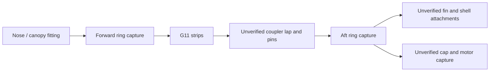

# G80 capture B versus C: hand preflight

**Final integrated decision:** see [capture decision](wo03-g80-capture-decision.md).
The evolving preflight/partial ledgers below are preserved; final stock-only
accounting is at the end. The supplemental audit also identifies the short
B pin, eccentric rail bending and explicit thermal-route limitations.

**Neither proposal is ready for CAD admission.** B's single unreinforced
rail-pin load path fails a conditional gross section screen. C has enough
*ideal total* G11 strip area for the already-factored recovery load under
perfect sharing, but one strip cannot carry it, and the proposed strips touch
the source fin-channel boundary with zero clearance. Its end connections,
module joint, forward installation, load sharing and new mass remain undefined.
These are preflight findings, not validated vehicle designs. No CAD, FEA or
thermal run was made.

The source is the isolated 72-part `90b2a9…2bdfc` geometry and the separate
73-part canopy/5 g sensitivity ledger. The saved as-run 73-part YAML has
0.794581712 kg loaded mass before the separate full 0.050 kg growth allowance;
the metadata-corrected `6b0577…d1dc4` identity is not the as-run YAML identity.
The 5 g line/connector amount is a sensitivity allocation, not a physical
part definition. Source hashes and the arithmetic are in the
[preflight record](../build/wo03-g80-capture-comparison-v1/preflight.json).
Neither candidate inherits flight, fit, joint, thermal or strength acceptance.

## B — relocated bolt seats and cross-pinned rails

A concrete first envelope for comparison is three G11 fork seats, each two
7 × 2 × 15 mm lugs flanking a rail, with a 3 mm transverse pin through a
3.2 mm bore at mount-local z = 185 mm. Put the retainer bolts at R25.5 mm on
rail axes 0°/120°/240°. The path would be cap → through-bolt/nut/washer → G11
seat → pin bearing → plywood rail → separately demonstrated rail/ring/body
connections. The pins, retaining features, seat-to-bolt bearing, end distance,
tear-out, local rail crushing and body attachment are all actual joints to
specify and screen. No rail is grounded by assertion.

Existing cap holes are at 60°/180°/300°, so each new bore moves **25.5 mm by
chord** and requires an altered cap, guides and capture geometry. The 185 mm
pin station is beyond the nominal fin-channel end at z = 180 mm, but its pin
access, retained motor/nozzle and remaining ring/guide geometry are not
verified. At the original z = 172–180 mm channel, the full 7 × 12 mm rail
section is absent; it cannot be credited there.

Under the existing 150 N service reverse load, the one-bolt sensitivity is
450 N after DF3. With a single pin in an optimistic intact 7 × 12 mm rail,
`450/(3×12) = 12.50 MPa` projected pin bearing and
`450/[(7−3.2)×12] = 9.87 MPa` gross remaining axial section. If the generic
estimated plywood weak-direction **10 MPa** value is provisionally applied
to both bearing and net section, feasible pin diameter would need to be at
least 3.75 mm for bearing while the bore would have to be no more than
3.25 mm for net section. That incompatible ideal bound ignores edge tear-out,
tolerances and load eccentricity. It is a useful reason to stop this
**unreinforced** B envelope before expensive CAD, not proof of actual material
failure: neither plywood bearing nor net-section hot allowable is known.
Reinforcing the rail or introducing another verified load path changes the
geometry and needs a primary decision; no credit is taken for the failed
bridge adhesive path.

The six uncut seat-lug blanks have 1,260 mm³ gross volume, or **2.331 g** at
1,850 kg/m³, before clipping or holes. Three pins, pin retainers, cap/guide
changes, local reinforcement, adhesives and any shields have unknown mass and
must be added; the blank value is not a complete candidate mass. If the
bridge and keeper are fully removed, their named 10.176847 g and 15.409675 g
are eligible credits once; the six M2 items total 1.32 g only if all are
actually removed. The itemized M3 set is **8.52 g** and stays once unless
replaced; the old unitemized 7 g budget was already removed from this source.
No displaced plywood or revised hardware mass is assumed without geometry.

## C — continuous G11 frame concept

A concrete bounding envelope is six 7 mm radial × 2 mm tangential G11 strips,
two alongside each rail axis, centered at ±4.65 mm tangential offset, extending
from vehicle station 225 to 1,200 mm. In the aft 100 mm channel region their
inner edges lie at ±3.65 mm, exactly on the nominal 7.3 mm fin-channel
boundary: **zero construction clearance**, with cylindrical clipping and
interfaces unresolved. The 975 mm strip length crosses the 0.500 m body cut;
the two modular body sections must actually be joined by a detachable,
load-bearing continuity joint at the real coupler. Front-end positive capture,
strip-to-strip/end-ring load introduction, aft cap/rail capture, axial
alignment, shell/fin clearance and service access must all be explicitly
dimensioned and modeled. An aft frame by itself is not a recovery backbone.
The body paper still requires its own 2 MPa screen wherever local anchors
transfer force into it; no bypass or independently retained body is assumed.

Six ideal uncut sections total **84 mm²**. The separate **1,782.253 N
already-factored** recovery sensitivity gives **21.22 MPa** if all six share
perfectly, against the estimated **25 MPa** hot G11 generic screen. One
14 mm² strip alone gives **127.30 MPa**, and the 450 N retention sensitivity
alone gives **32.14 MPa** on one strip. These are gross axial screens before
holes, cylindrical clipping, bending, unequal load, bearing and joints; they
are not a strength pass. Neither G11 laminate-direction hot strengths nor
joint bearing, interlaminar shear or hot adhesive/peel allowables are known.
The physical bridge is 2 mm thick; **1.5 mm is only the former mesh-size
setting**.

Six full rectangular strip blanks total **81,900 mm³ / 151.515 g** at the
source G11 density before clipping; this is neither installed net mass nor a
finished-part minimum. Add distinct front and aft end-capture rings, modular
connectors, fasteners/pins, sleeves, shields, adhesives and process loss after
defining their real volumes and mass bases. Only geometrically demonstrated
removed source solids can be credited; the potential bridge, keeper and M2
credits above must not be subtracted twice. The source's 12 g finish, 8 g fin
bond, 4.620026 g incremental mount-gap and 1 g retention-locking allocations
remain once each, with their sufficiency unproven. All new physical components
need individually calculated volume, CG and full inertia before a 73-part
vehicle mass/tensor can be reported; the independent 50 g growth remains
separate.

Before any bounded CAD child, the primary must decide whether to reinforce B
and how, or specify C's clearance-preserving strips and real module/end
connections. Subsequent nominal CAD would use one requested CPU, at most
120 CPU/120 wall seconds per option, 2 GiB supervised-root RSS, and an overall
420 CPU-second reservation including setup and parent. Stop on the first
invalid geometry or resource cap; no automatic retries or cap increases. No
such CAD execution is authorized by this preflight.

## Outbound interface and partial mass screen

The exact coupler spans stations **0.868–0.972 m** with nominal bore radius
**30.5 mm**. The C strips above occupy the radial interval approximately
25–32 mm and intersect that coupler. Even an optimistic cutback entirely inside
the intact coupler, at the outer tangential strip edge 5.65 mm, leaves radial
extent at most `sqrt(30.5²−5.65²)−25 = 4.972 mm`: six 2 mm-wide strips then
have at most **59.665 mm²** gross cross section and an ideal uniform
`1782.253/59.665 = 29.87 MPa`, above the estimated 25 MPa G11 hot screen
before joints or holes. The coupler is not a credible rigid ground. The
specific obstruction is geometric and remains even if the separate paper
shell is ignored.

One finite redesign for future consideration would displace each strip inward
near the coupler with a **20 mm mechanical lap at each end**, six strips and
12 lap locations. An illustrative inventory is 12 G11 7 × 2 × 20 mm splice
plates (**6.216 g uncut**), 24 nominal 3 × 8 mm G11 pins (**2.511 g**) and
48 nominal G11 washers, OD 6 mm / ID 3.2 mm / 1 mm thick (**1.797 g**), at
1,850 kg/m³. Two 4 mm thick uncut G11 end-ring blanks with radii 15.8–32.2 mm
would be **36.601 g** together. These are defined stock-volume counts, not
verified shapes or available hardware: the lap fit, 3 mm hole edge distances,
pin retention, ring clipping, coupler wall, avionics and motor/nozzle
clearance have not been established, and no pin, washer, ring or adhesive
strength is credited. The nominal aft ring bore clears the motor's nominal
14.5 mm radius by 1.3 mm radially, but that is not a nozzle/service clearance.
The 20 mm laps are a proposed module interface, not proof that an assembled
module can separate or be serviced.

The intended outbound path is canopy/nose positive end fitting → forward G11
ring and its six mechanically captured strip ends → 12 finite lap connections
across the modular coupler → aft strips/end ring → finite fin-root and mount
captures → retained motor through the cap and M3 hardware. The shell and
payload need separately specified and checked attachment points to that frame;
a ring sitting inside the tube is not a body connection. Any shell attachment
that uses paper locally must satisfy the source 2 MPa estimated paper screen,
including bearing and tear-out. The geometry and force allocation of those
connections, the retainer-to-frame coupling, thermal shields and adhesive
coverage remain missing. Consequently there is **no credible complete
outbound path under the present dimensions**, and no support, shared pin,
adhesive or ground reaction is invented. The finite inward-lap redesign is a
specific next geometry definition to resolve, not permission to run it.

For mass sensitivity only, the existing staged vehicle mass core was applied
to the 73-part as-run source, the bridge, keeper and six M2 items were removed
once, and the separate full 50 g growth was added at station 1.212 m. B adds
six untrimmed G11 7 × 2 × 15 mm fork lugs at the proposed aft location; C adds
six untrimmed 975 × 7 × 2 mm strips. The resulting **partial, deliberately
noninstalled** screens are:

| Partial bookkeeping case | Mass including growth | Axial CG | Body inertia tensor about CG, kg m² |
| --- | ---: | ---: | --- |
| B, lugs only | 0.820006 kg | 0.801516 m | `[[0.000903600, 0.000190188, −0.000173545], [0.000190188, 0.143173096, −0.000000114], [−0.000173545, −0.000000114, 0.143175042]]` |
| C, strips only | 0.969190 kg | 0.786667 m | `[[0.001028649, 0.000189953, −0.000165390], [0.000189953, 0.155874243, −0.000000112], [−0.000165390, −0.000000112, 0.155876132]]` |

These are mathematical untrimmed rectangular-prism sensitivities, **not CAD
volumes, installed totals, CG/tensor bounds or mass passes**. B excludes its
three pins, pin retainers, changed cap/guides and reinforcement. C excludes
both end-ring blanks, all lap inventory above, retainer/fin/shell attachments,
shields and adhesive. The illustrated C rings and lap stock sum another
**47.125 g** before clipping and assembly features, so even the illustrative
subtotal is about **1.016315 kg**, without a final CG/tensor. No old source
volume other than the specifically listed bridge/keeper/M2 items is credited.
The source M3 set, finish, fin-bond, mount-gap and locking allocations remain
once. A first validation against the active root CAD revision correctly
reported stale caches; the mass calculation used the source-identical isolated
staged schema and mass core, without regenerating or overriding CAD caches.

For B's first stock budget, three hypothetical 3 × 12 mm G11 pins and six
6 mm OD / 3.2 mm ID / 1 mm G11 washers would add **0.471 g** and **0.225 g**
uncut respectively; their real retention features, pin engagement, altered
cap/guide, local reinforcement, shields and adhesive still have no defined
mass. Adding these blanks to the partial B arithmetic gives about **0.820702 kg**
including growth, not a final mass or an updated CG/tensor. The component
stock estimates are not supplier weights or usable mechanical ratings.

## Decision and stock-only accounting

**Neither as-specified option clears its early credibility screen.** No CAD or
FEA is admitted for either, and no pin-size or thicker-strip search is part of
this comparison. B's conditional impossibility argument assumes its pin axis
runs through the **full 12 mm tangential rail width** and, optimistically,
that the entire 450 N can be carried there without a reduced contact length;
the 7 mm radial section is the width interrupted by the transverse bore.
The 10 MPa value remains a generic weak-direction estimate, not an established
bearing, hot or joint allowable. C's stated coupled-bore bound assumes ideal
uniform sharing and an intact 30.5 mm-radius coupler bore; the proposed strips
otherwise intersect that coupler. No installed requirement is closed.

The load paths and their currently weak outbound joints are:

The now-complete **defined stock inventory**, including the illustrative
pins, washers, lap plates and two annular blanks, is specified by count,
dimensions and nominal position in the study YAML. The source-identical
isolated staged mass core calculated all tensors using uniform uncut stock;
the original 73-part source and separate 50 g at 1.212 m were used. The
explicit-credit column removes the source keeper, bridge and six M2 items
once; the conservative no-credit arithmetic retains them all. Both retain
the source M3 set and existing mass allocations. These are **stock-only
bookkeeping scenarios**, not installed masses, upper/lower bounds or passes:
intersections, clipping, changed cap/guides, actual body/fin attachments,
shields and adhesives remain undefined. Full off-diagonal tensors and source
hashes are preserved in the [stock mass record](../build/wo03-g80-capture-comparison-v1/stock-mass-record.json).

| Option / credit assumption | Mass including 50 g | CG station | Ixx / Iyy / Izz, kg m² |
| --- | ---: | ---: | --- |
| B, source items credited once | 0.820702 kg | 0.801850 m | 0.000904181 / 0.143280955 / 0.143282901 |
| B, no source credits | 0.847608 kg | 0.813851 m | 0.000921061 / 0.147013641 / 0.147015575 |
| C, source items credited once | 1.016315 kg | 0.785376 m | 0.001061066 / 0.165004537 / 0.165006412 |
| C, no source credits | 1.043221 kg | 0.795552 m | 0.001077942 / 0.169093732 / 0.169095600 |

The primary's next **direction**, not a third executed option or accepted
package, is a short mechanically captured G11 aft subframe with rail-aligned
seats and terminal members connected to the selected aramid backbone through
the coupler. The body, fins and retained motor each need a separately defined
positive capture and free-body path. That future design must bound pin and
bearing/net section, unequal load sharing and local paper/body attachment,
protect the existing performance objective, and recalculate mass/CG/inertia,
stability and flight. No present stock number supplies those missing
connections or proves the backbone's serviceability.
