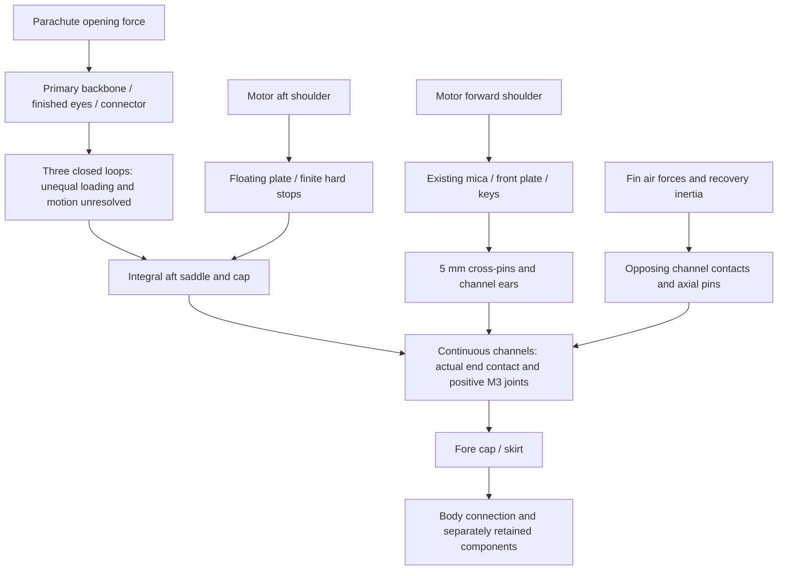

# Connected G80 aft receiver and launch decision

**Decision: retain the connected load-path layout for further design, but do
not admit this heavy, constant-section S3 construction to detailed CAD/FEA.**
The replacement budget is494.101g, producing1149.622g nominal plus the separate
50g allowance =**1199.622g**. Its unchanged external fins give only**0.205cal
loaded /0.408cal burnout**, below1.0. A longer guide cannot close this failure.
Complete intrinsic inertia, installed strength/flutter and thermal acceptance
remain unavailable. No active vehicle or preview geometry was changed.

The parallel [launch/motor comparison](wo03-launch-guide-motor-trade.md)
demonstrates that the earlier approximately1kg guide-model result is **not a
universal rocket limit**. Keep G80 first and investigate a confirmed, supported,
compatible **1.8m usable** setup as the preferred planning option. Keep the
1.5m baseline unchanged until the equipment/button/interface dependencies close.
The fallback is a lighter G80 package meeting that existing1.5m screen; this S3
construction does not. A2.4m usable supported guide is a further conditional
equipment option, not established local access or a way to waive stability.

## What became physically defined

The former S2 aft foot began3.8mm behind the retained wood rail ends. S3 removes
that wood frame and the independent compression tube, and makes three G11
channels continuous from1010 to1211.8mm. Their end faces directly meet the fore
cap at1010 and aft cap at1211.8. Nominal face gaps are zero by dimension.
Machining, end contact, assembled alignment, deflection and strength are still
unverified; a coincident datum is not a CAD intersection or proof test.

All dimensions are millimetres, with axial station increasing aft from the nose.
G11 is a glass-fibre/epoxy laminate. A channel is an open-sided structural beam;
its sides capture the fin tab while its remaining section connects the ends.

| Connection | Dimensioned construction | Load path / remaining verification |
| --- | --- | --- |
| Continuous channels | Three19.5mm tangential ×14.1mm radial sections; radial16.2–30.3; full6.95×12 channel; length201.8; axes0/120/240° | End bearing plus positive cap fasteners; no old3.8mm spacer, unconnected foot or commercial-case structural credit. Holes, local buckling and cap flexibility remain. |
| Fore/aft caps | Integral G11 annuliR12–32,6 thick at1004–1010 and1211.8–1217.8 | End faces meet the channels; each cap has three integral9mm-radius saddle lobes with radial-axis width12.7, centeredR24 at60/180/300°. No adhesive butt joint is substituted. |
| Positive cap retention | Six axialM3 joints, one per channel per end; captive transverse6×6 barrel nuts in one channel ear, centers1024/1203.8;6.2 cross-bores;8/3.4×0.5 washers |27±0.1 fore and19.5±0.1 aft finished screws. Blind bore depths32/14. Exact grade, thread engagement, local ligaments, washer flexure and access need qualification. Screw sets are4g allocations each. |
| Forward motor stop | G11 plate1063–1069; centralR12–18.3 annulus and three6.6-wide radial prongs toR30.3; existing mica pads1069–1072 | Three12×6.6×12 keys1051–1063 bear on5mm cross-pins at1057. Actual shaft, keys and channel sides carry the force; no ideal grounded support. |
| Independent aft motor capture | Floating4mm G11 plate1203–1207,3.2mm aft travel;1.6mm hard-stop spacers meet aft cap1211.8 at maximum travel | Separate cap screws/channels retain it independently of recovery straps. Springs/keepers have6g allocation; actual spring, nozzle and case ends remain unresolved. Current cap's service obstruction is a failure below. |
| Fin capture | Existing6.35mm plywood fin/gussets, tab deepened from6 to14.7;100mm tab1090–1190; channel contact over12mm | Controlled6.30–6.40 tab and6.90–7.00 channel require selected per-flank shims to0.01–0.03 total clearance. This is a manufacturing requirement, not measured fit. |
| Positive fin axial retention |5mm tangential pins at1180,R24.3, through5.3mm holes;10mm to tab end | The pins stop axial loss. Their axes are parallel to fin-normal load, so they are not credited as fin-normal shear keys or a rigid root clamp. Side contacts carry bending. |
| Body connection | Integral fore skirt974–1004,R31–32, with real clearance windows995–1004;0.3–0.7 radial adhesive layer; six radialM2 retainers and G11 washer footprints | Ring to skirt to bond/fasteners to actual body. Average bond shear is only one check; serial paper strength, peel, crushing and component retention remain open. |

Six slots per cap,13.0 radial ×1.4 tangential, centeredR24/tangent±9, give
the straps a real path through the solid caps. The fore skirt has three open
60° windows around the saddle axes over995–1004. These avoid an impossible
strap/solid-wall overlap. They are **actual openings for future heat analysis**;
neither hidden solid shielding nor duplicate full-area glue/air transfer is
permitted there. The gross mass ledger takes no material-removal credit for
the strap slots or fastener holes. The configured skirt windows alone are
deducted, giving25.5mm equivalent full-circumference length.

This is an intended load-path graph, not a verified reaction solution. Closed
loops and end bearing can create compression, while eccentricity, unequal
loading and cap bending can also demand tensile restraint. No claim that all
cap reactions remain compressive is established. The positive M3 joints must
therefore be assessed for recovery as well as the separate450N reverse-motor
screen. The physical upper/nose/payload terminations also remain required;
the diagram does not assign the whole recovery force to the paper wall.

## Executed complete preliminary mass and balance screen

The source73 nominal794.582g retains its original parts except the
named139.061g frame/retention bundle removed once. Its remaining655.521g is
retained; full50g growth is added once at1227mm. Existing12g finish,8g fin
bonds,4.620g gap allocation,1g locking and5g canopy allowance remain counted.
The old7g hardware lump is not removed again. The new5g rail-button conversion
reserve is additional to the old0.623g lugs, not a selected button assembly.

| New package group | Estimated mass |
| --- | ---: |
| Three net-section continuous channels |214.534g |
| Two annular caps and six integral saddle lobes |79.310g |
| Windowed integral fore skirt |9.337g |
| Motor plates, prongs, keys and hard stops |21.468g |
| Six cap screw/barrel/washer/lock sets |24.000g |
| Six clevis/washer/cotter/shim sets |39.000g |
| Deeper fin tabs, incremental only |11.850g |
| Three raw webbing loops and extra backbone |38.602g |
| Body adhesive/retainer allocation |9.500g |
| Spring/keeper, shims, chafe/stitching, shielding, connector, service, button and fairing allocations |46.500g |
| **Complete preliminary replacement budget** |**494.101g** |

This is a complete **planning ledger of the named arrangement**, containing
explicit allocations where hardware or protection is unselected. It is neither
measured mass, a reconciled CAD result nor a conservative bound. Loop seam and
connector geometry, process adhesive, springs and heat-protection design still
need resolution; nominal allocations cannot qualify those functions.

Loaded full mass1199.622g gives balance point892.599mm. Motor-burnout full
mass1137.122g gives879.220mm. The external fin geometry remains unchanged, so
the existing small-angle Barrowman calculation returns aerodynamic-force
location906.140mm and margins0.205/0.408cal. One calibre means one66mm body
diameter between balance and aerodynamic-force locations. Both fail the
unchanged1cal gate; no rounding closes them. Exact motor CG, uncertainty and
reference revalidation remain additional dependencies.

Full inertia—the resistance to rotation about each axis—is **unavailable**.
The saved point-distribution contribution of new items is about0.0309kg·m²
about each transverse axis; it omits their intrinsic inertias and is not a
full candidate tensor. This gap is separate from the already decisive mass/
stability failures and prevents a reconciled vehicle claim.

## Launch setup and opening loads evaluated together

The primary ran one candidate at three usable distances with the source-pinned
existing guide calculation: thrust×0.85, friction0.5N, Cd0.8, constant loaded
mass and full50g. No free flight, JAX trajectory campaign or RocketPy flight
comparison was run for S3, which already fails admission.

| G80/S3 assumed usable travel | Departure speed |15m/s formal |15.5m/s planning |
| --- | ---: | --- | --- |
|1.5m unchanged reference |13.200m/s |Fail |Fail |
|1.8m conditional option |14.469m/s |Fail |Fail |
|1.971m illustrative10ft geometry |15.146m/s |Conditional numerical pass |Fail |

For S3's1227mm tail, source upper-lug front250mm and assumed100mm pad offset,
the start/release loss is1.077m. A clear10ft/3.048m guide gives1.971m usable;
1.8m usable needs at least2.877m clear overall. Current lugs are not1010/1515
buttons. Exact button/head release, attachment, pad stop, support stiffness,
wind and actual club equipment remain unverified.

At1.971m the guide-model total limits are1219.953g at15m/s and1152.316g at
15.5. S3 has only20.331g formal mass headroom and is47.306g above planning,
before component uncertainty is resolved. Those numbers are model-specific,
not a universal mass cap. The project physical ceiling remains below1500g,
including growth, and is not a target weight.

The unchanged severe opening equation at1199.622g is
`3*m*(20.4²/(2*0.3)+9.80665)` =**2531.467N**; the5m/s case is185.246N.
Motor-burnout severe demand is2399.578N. These are energy-equivalent mean
screens, not measured peak tensions. Neither longer guide nor lower early
thrust reduces this prescribed case. Every later mass change requires a new
opening calculation.

## Strength, fit and practical findings

| Item | New quantitative result | Acceptance / remaining issue |
| --- | --- | --- |
| Main channel / end contact | One full-force channel mean13.216MPa;50% end contact26.431MPa,75%17.621MPa against provisional25MPa. Ideal pinned Euler4147N atE5GPa | No installed strength/buckling pass. Actual ends, holes, local modes, eccentricity and finite cap/support stiffness remain required; no rigid bracing credit. |
| Cap retention |450N case M3 tension89.46MPa; one-ear barrel mean11.95MPa; washer10.93MPa | Generic screens and complete dimensions do not qualify grade, threads, pull-through, prying or hot laminate directions. |
| Recovery cap sensitivity | Full2531N through one M3 would demand503.27MPa; one-ear mean67.24MPa; aft end tearout41.17MPa | Adverse against provisional200MPa steel/25MPa G11 scalars. Until recovery compression/contact signs and unequal reactions are established,450N-only sizing does not close this joint. |
| Loop / saddle | Full-force/moving-junction sensitivity gives24.814MPa at full12.7mm width;33.085MPa at75% effective width |75% case fails25MPa screen. Raw webbing/marine connector breaking loads are not finished hot eye, stitch, bend or multi-leg capacities. |
| Body |450N through plain paper annulus gives4.374MPa versus estimated2MPa; full recovery through it would give24.604MPa.75%-covered skirt shear is0.117/0.658MPa respectively | Broad bond shear alone does not close the serial paper cut, normal/peel or bearing. Actual component-specific freebodies and a positive reinforced body path remain required. |
| Installed fin contact | Corrected opposing half-depth patch model:149.42N net,5.2297Nm moment; patch forces946.34/796.91N over600mm² each, mean1.577/1.328MPa | Wood bearing range1–5MPa crosses these demands; peaks and compliance unavailable. The original favorable0.363MPa full-face proxy is superseded by the primary audit. |
| Fin pin / motion | Own-fin recovery inertia100.92N; mean bearing3.179MPa;5.3mm-hole corrected end-tearout mean0.467MPa; geometric freeplay0.175mm | No directional capacity, installed1mm deflection or flutter pass. Freeplay excludes elastic panel/root/contact motion. |
| Radial thermal fit |0.200mm minimum cold clearance under stated tolerances;0.108mm after G11 growth to150°C versus0.1mm requirement | Only0.008mm conditional margin. Component temperatures, material expansion, moisture, exact geometry and alignment remain unmeasured. |
| Axial motor growth | New3.2mm travel less0.5 manufacturing loss gives2.7; archived source maximum relative closure2.0352 leaves0.6648mm | A bounded-input clearance sensitivity, not a temperature prediction or verified polymer/nozzle envelope. Springs, motion and positive hot retention remain unqualified. |
| Motor service | Permanent cap bore24mm is smaller than29mm motor; one-piece floating bridge also cannot pass independently | **Fails independent motor removal.** Aft cap/loop removal would disturb primary recovery. Next interface must retain the recovery cap while removable motor clips pass through a sufficiently large clear bore. |

The primary's [read-only connection audit](../runs/wo03-g80-connected-receiver-20261102-v2/connection-audit.json)
uses actual bore radii for net ligaments, adds the full-recovery cap sensitivity
and replaces the favorable fin full-face proxy with opposing half-depth patches.
Patch forces satisfy both force and moment to floating-point precision; this
only verifies arithmetic, not pressure distribution or capacity. Local peak
pressure is unavailable. The v2 raw record is unchanged and retained.

## Assembly, heat and configuration consequences

The candidate sequence is: machine/inspect bare channels, integral caps and
keys; route the three loops through actual slots/windows; assemble positive
cap joints; insert the cage from the aft end of the slotted paper module;
bond/retain the fore skirt; insert and shim the fins; insert their cross-pins
through service ports; install motor/pads and aft capture; connect the separate
recovery unit while retaining its independent battery and arming access.

Six5mm pins need twelve11.5mm shell access ports at1057/1180. Head, cotter and
shim budgets are included, but the ports further weaken the paper. Removal
paths and actual tool/wire/connector envelopes require CAD. Motor removal in
the present arrangement requires releasing the aft recovery cap and is a
recorded design failure, not a completed service sequence. Battery/switch
locations in the forward independent recovery package remain unchanged; its
earlier packing, electrical and extraction qualifications remain open.

G11 channels/end caps create new conduction paths to the body, and true skirt/
strap/service openings create radiation and gas routes. The6g thermal item is
an allocation, not an adopted shield. Preserve all required burn/soak cases,
including300°C case +contaminated foil +35°C ambient and the45°C paper/wood
screen. No temperature field or thermal pass exists for S3. The closed,
unqualified thermal-tool campaign is not restarted by this construction study.

The fixed G80 plate positions cannot be transferred to187mm G54 hardware.
Exact forward/closure/nozzle, liner and support changes remain necessary;
the launch study's20g reserve is only a sensitivity. G12's moving motor,
longer heat exposure and PID-to-RL mission need their own aft module; the
shared upper/recovery interfaces remain a goal, not automatic compatibility.

## Next bounded construction decision

Keep the physically connected end-joint/load-path datums as the design basis.
Replace the **214.534g constant-section channels** with a lighter continuous
closed-section or locally reinforced construction, keeping actual cap, fin,
motor and body functions. Do not credit its mass reduction until the local
shoes/joints, heat protection and reinforcement are counted. At the preferred
conditional1.8m source model the gross replacement budget is357.990g, so this
ledger needs136.111g reduction; the198.333g1.5m planning budget remains a
separate reference. The large aft mass must also be corrected or matched to a
justified aerodynamic/placement change; no rail length fixes0.205cal.

The aft motor interface must change to a permanent recovery receiver with a
large enough motor opening and independently removable retention pieces.
Body force transfer and finished hot harness/contact remain joint acceptance
items. No further physical variant, native mesh, stress solve or flight is
admitted by this failed screen. Reopen detailed work only after a complete
lighter revision passes the applicable mass, stability, connection and service
preflight. This preserves substantial custom fabrication and the G80-first,
G54-upgrade and G12/PID-to-RL objectives.

Source and dimensions: [S3 YAML](../configs/studies/wo03-g80-connected-receiver.yaml).
[Executed v2 result](../runs/wo03-g80-connected-receiver-20261102-v2/record.json)
used0.502CPU/0.581wall seconds under20CPU/30wall; the earlier interpreter and
input-key failures are preserved in v1. Failed v1 CPU is unavailable, with
observed invocation wall0.532s; do not report it as zero. The one primary
read-only audit had a separately declared2CPU/5wall cap and did not rerun the
guide/geometry packet. All physical, purchase, paid-run, WO-10 owner-review
and flight-release gates remain unchanged. Planning cost is$205 before tools,
shipping/tax and owner labour, an estimate rather than supplier quotations.
