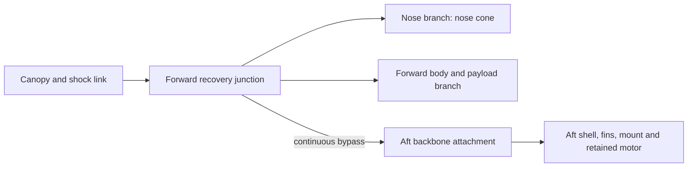

# G80 recovery branch mass and demand screen — corrected 73-part sensitivity

**Purpose:** provide mass-accounting and freebody inputs for a later exact
anchor-layout decision. This is not an installed recovery design, capacity
calculation, hardware selection, opening-shock estimate, or acceptance result.
It reads the existing mass ledger for the corrected 73-part canopy sensitivity
only; it changes no active specification and runs no flight, CAD, or solver.

## Candidate and source identity

The analyzed candidate is the corrected canopy +5 g allocation sensitivity,
identity `6b0577cef1256065f27dc79bb494a89e6c1f0c90703c9815f47c7ae7910d1dc4`.
It contains 73 mass-ledger entries and derives from staged 72-part identity
`90b2a9ad780fc81d11171363432c46088531817ddb6570fe9f800429bde2bdfc`. The
corrected 6b metadata copy keeps the sensitivity's shared-model arrays
unchanged; its additional 5 g connector/line allocation remains a modeled
mass item, not a defined physical part or measured hardware mass. This note
does not use the separate 72-part ledger as a substitute.

The mass inputs are read from the 73-entry `part_ledger` in
[recovery-path record](../runs/wo03-g80-recovery-path-20261101-v1/record.json),
which identifies the corrected 6b identity and the source spec. Relevant
SHA-256 values:

| Artifact | SHA-256 |
|---|---|
| Stage 3 sensitivity input arrays `runs/wo03-g80-canopy-stage3-20261101-v1/sensitivity.yaml` (retained unchanged in 6b equivalence) | `6962dda2e123ac3528f75136f62b065d742e917712fc2dcef2dfc0a40a675967` |
| Corrected 6b metadata copy `sensitivity-metadata.yaml` | `8dfac23cf7fb41d7a24736b264fcc6203896e0cf6526bcee33a2f71165c0e231` |
| Stage 3 identity-equivalence record | `eba53aa8fdf37ab1a6211ed2a72436d907e9f6d5f33b8cad66ed7d941d49fe4f` |
| 73-part recovery-path mass ledger record | `940d9dd79a3e5b45bf856f280883117e0fa151b64f2c19a710f07e4e0495e317` |
| Engineering input config | `f5bb3c0fdb6abf4adf8628c76316302192ad779343a3a8188e01f2928c5a1678` |

The Stage 3 correspondence records the +5 g as an estimated part distributed
at the inherited canopy envelope; its mass is included once in the forward
recovery-interface accounting below. The complete 50 g growth allowance is
separate and assigned aft at 1.212 m, as directed for this screen.

## Proposed topology and mass ownership for bookkeeping

The proposed path follows the recovery-backbone trade: canopy/shock link to a
junction, then separate nose and forward-body/payload branches, plus a
continuous backbone that bypasses the 0.500 m body-tube cut and removable
module joint to a dedicated aft attachment. The diagram is a force-path
hypothesis. It does not assert that any listed component is actually attached
to its branch.

For count-once bookkeeping, distinguish the body/payload branch from mass on
the chute side of the junction and components whose topology/ownership is
uncertain. The 51.6 g canopy is on the chute side of the junction, so it is not
included in the known forward-body branch freebody. The 25 g group (shock cord,
protection, anchor and +5 g connector/line sensitivity) has no resolved force
ownership. The nose is its own branch. The straddling body tube and three
non-solid aft budget entries remain a further 69.652 g of unknown allocation.
Every ledger entry is still counted exactly once in the candidate total; branch
ownership ranges below are alternatives, not additive maxima. Per-part
identities, stations and classifications are retained in the linked ledger.

| Load-path bucket | Counted mass and included basis | Loaded / burnout branch mass |
|---|---|---:|
| Nose branch | `nose_cone` | 33.017 g / 33.017 g |
| Forward body/payload branch, known | Wholly-forward ledger entries excluding nose and the chute/recovery-interface items; includes forward body/payload/electronics group. | **157.466 g / 157.466 g** |
| Canopy on chute side of junction | `parachute`; kept distinct from the body/payload branch. | 51.600 g / 51.600 g |
| Recovery-interface ownership unresolved | `shock_cord` 10.000 g + `recovery_protection` 6.000 g + `recovery_anchor` 4.000 g + `canopy_line_connector_sensitivity` 5.000 g. These have no completed topology/load-owner assignment. | **25.000 g / 25.000 g** |
| Aft backbone / aft assembly, known wholly-aft parts | All `included_wholly_aft` ledger entries sum to 457.846 g loaded, including a 128.200 g motor and 329.646 g other listed aft parts. Add the separate full 50 g growth allowance at 1.212 m once. At burnout subtract 62.500 g propellant from the motor only. | **507.846 g / 445.346 g** |
| Unallocated straddling solid | Entire `body_upper` ledger mass is 56.032 g; its saved span is 0.140–0.918 m and crosses the 0.500 m cut. The mass model has no segmented mass or attachment model here. | **0–56.032 g** may be assigned to either body branch; total counted once |
| Unallocated distributed budgets | `fin_bonds` 8.000 g + `incremental_mount_gap_epoxy_upper_budget` 4.620 g + `retention_locking_materials_reserve` 1.000 g = 13.620 g. They are non-solid budget entries, not verified joints. | **0–13.620 g** may be assigned to an appropriate supporting branch; total counted once |
| Full candidate, with ambiguity included | 73-entry sensitivity part ledger totals 794.582 g. Add the separate 50 g growth once. Burnout removes only the motor's 62.500 g propellant. | **844.582 g / 782.082 g** |

The known mass buckets sum to the exact 73-part total: nose 33.017 g + forward
body/payload 157.466 g + canopy-side 51.600 g + recovery-interface-uncertain
25.000 g + wholly-aft 457.846 g + straddling/budget-unknown 69.652 g = 794.582
g. Add the separate 50 g growth once for 844.582 g loaded; burnout subtracts
62.500 g motor propellant once. The 25.000 g interface group and 69.652 g
straddling/budget group are separate. The branch bounds below can assign the
25 g and/or the 69.652 g to one branch at a time; do not add upper bounds from
different rows. The canopy's 51.6 g is not available to the forward-body branch
upper bound because it is above the junction.

## Existing recovery demand cases and branch subsets

Only the existing 5 m/s nominal-opening probe and 20.4 m/s archived severe
delay probe at 0.3 m stopping travel are used. With gravity and DF3 applied
once:

`F_screen = 3 m (v² / (2 × 0.3 m) + 9.80665 m/s²)`.

The 20.4 m/s case is not an approved delay or operational limit. This constant-
deceleration screen does not model opening shock. The established full-loaded
primary-backbone screening demand remains **1,782.253 N**. The entire primary
backbone and its terminations remain screened to that existing full value; the
subset numbers below are freebody context and do not reduce that screen.

| Retained mass subset | Mass used | 5 m/s, 0.3 m | 20.4 m/s, 0.3 m |
|---|---:|---:|---:|
| Nose branch | 33.017 g | 5.10 N | 69.67 N |
| Forward body/payload branch, known ledger mass only | 157.466 g | 24.32 N | 332.29 N |
| Forward bulkhead branch if it also retains all 25 g interface-uncertain and 69.652 g straddling/budget-unknown mass | 252.119 g upper bound | 38.93 N | 532.03 N |
| Canopy on chute side of junction | 51.600 g | Not treated as a body-branch freebody; no separate canopy-link transient calculated | Not treated as a body-branch freebody; no separate canopy-link transient calculated |
| Recovery-interface-uncertain group | 25.000 g | Not assigned to a physical branch; included in forward bound above only as one limiting allocation | Not assigned to a physical branch; included in forward bound above only as one limiting allocation |
| Aft backbone / assembly, known wholly-aft parts + full 50 g growth, loaded | 507.846 g | 78.42 N | 1,071.67 N |
| Aft branch if it retains all 69.652 g straddling/budget-unknown mass, loaded | 577.498 g upper bound | 89.18 N | 1,218.65 N |
| Alternative aft upper bound if it also carries the 25 g topology-uncertain interface group | 602.498 g upper bound | 93.04 N | 1,271.40 N |
| Aft backbone / assembly, known wholly-aft parts + full growth, motor burnout | 445.346 g | 68.77 N | 939.78 N |
| Aft branch with all 69.652 g straddling/budget-unknown mass, motor burnout | 514.998 g upper bound | 79.53 N | 1,086.76 N |
| Alternative aft upper bound with both unknown groups, motor burnout | 539.998 g upper bound | 83.39 N | 1,139.51 N |
| Whole candidate, loaded including 50 g growth | 844.582 g | 130.42 N | **1,782.253 N** |
| Whole candidate, motor burnout including 50 g growth | 782.082 g | 120.77 N | 1,650.36 N |

All branch values scale the respective retained mass by the same prior
screening acceleration. The branch table does not establish equal sharing,
actual simultaneous forces, restraint stiffness, or an opening pulse. The
entire 50 g growth allowance is in the aft branch as requested; when the motor
burns out, its 62.5 g propellant is removed from the aft and whole-candidate
mass once. The alternative aft rows allocate both unknown groups to aft
instead of to the forward upper-bound row; those alternatives cannot be
combined. They are accounting bounds, not evidence that a 25 g
recovery-interface item is attached to the aft assembly.

## Forward bulkhead implication

- **If the continuous backbone bypasses the forward bulkhead and the nose has
  its own positive branch**, the bulkhead's attached forward-body/payload
  branch is screened by its known branch freebody: **24.32 N at 5 m/s or
  332.29 N at 20.4 m/s**. If all 25 g of interface-uncertain mass plus all
  69.652 g of straddling/budget-unknown mass is ultimately assigned to the
  forward branch, the upper bookkeeping values are **38.93 N and 532.03 N**.
  The 51.6 g canopy remains on the chute side and is excluded from these branch
  loads. These are demands only, not capacity or evidence that the bulkhead
  carries exactly these loads.
- **If the recovery force enters the forward bulkhead and the serial body path
  carries the entire vehicle**, that bulkhead/load introduction sees the whole
  existing screen: 130.42 N at 5 m/s or 1,782.253 N at 20.4 m/s, loaded with
  the 50 g allowance. The motor-burnout severe case is 1,650.36 N. A local
  spreader alone does not bypass the tube cut.
- The separate nose branch has its own estimated 69.67 N severe subset demand
  (5.10 N nominal); the current nose shoulder has no positive recovery anchor.
  A path bypassing the bulkhead still needs explicit branch attachment and
  payload restraint. The static 60° tether route has no termination, bend,
  slack, deployment, or service-loop model.

These calculations support a later exact anchor layout only. They establish no
capacity, margin, material allowable, attachment design, physical pass, or
hardware selection. The previous whole-load backbone criterion and the open
recovery, thermal, structural, deployment, and owner physical-test gates remain
unchanged.
