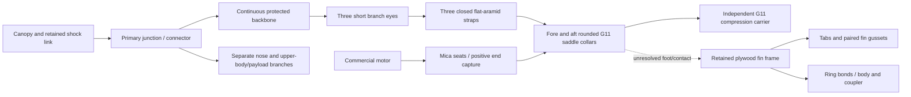

# IF-RECOVERY-001: S2 coupled saddle/strap admission study

**Decision: do not admit S2 to detailed CAD or analysis.** The diagnostic mass is
about125g below S1, but it still misses the declared useful guide margin, shifts
the balance aft, and does not close the actual frame/body contact or motor-case
isolation. No primary attachment has been qualified. The next design requirement
is a **common positively captured aft load receiver for the recovery carrier,
fin frame and body**, with an independent motor-retention/thermal stack. Do not
add another saddle to the same unresolved receiver or silently discard its mass.

Only one S2 geometry was evaluated. S1, the earlier B/C screens and all failed
thermal/bridge results remain preserved. G80 is the immediate integration track;
G54 and G12/PID-to-RL remain separate. The working vehicle and preview geometry
are unchanged.

## Compact comparison

All masses include the **separate full50g allowance**. S2 figures are diagnostic,
not an installed mass, conservative physical bound or accepted flight result.

| Quantity | Source73 canopy study | Rejected S1 | S2 diagnostic, one revision |
| --- | ---: | ---: | ---: |
| Nominal mass + separate growth | 794.582+50g | 1007.417+50g | 882.677+50g |
| Total | 844.582g | 1057.417g | **932.677g** |
| Shared mass-only guide departure | 16.095m/s | 14.190m/s | **15.230m/s** |
| Margin above required15m/s | +1.095m/s | −0.810m/s | **+0.230m/s** |
| Margin above study15.5m/s target | +0.595m/s | −1.310m/s | **−0.270m/s** |
| Required20.4m/s/.3m/DF3 opening screen | 1782.253N | 2231.382N | **1968.154N** |
| Balance point from nose | 812.500mm with growth | No accepted complete CAD estimate | **836.297mm**; partial location sensitivity±6.522mm |
| Connection status | Bridge hot bond adverse | Clevis bearing, heel length and guide fail | Tube average is favorable under a scalar estimate; contact fraction, soft loops, foot, keepers, body/fin and thermal stack remain unaccepted |
| Admission | Unadopted source | Rejected | **Not admitted** |

The study target15.5m/s was declared before S2 execution to reserve0.5m/s beyond
the unchanged15m/s requirement. In the same source guide model it corresponds
to about**903.854g full mass**, including growth. S2 needs approximately
**28.823g less mass** to reach it. This is a planning margin, not a replacement
launch requirement. The original15m/s ceiling remains about958.398g. No longer
guide is adopted and no reserve is spent to conceal uncounted hardware. Even
accepting the formal15m/s pass would not close the physical receiver, motor
stack, conditional stability or attachment-capacity findings.

## Opening-load audit

The retained equation is `F = DF × m × (v²/(2s) + g)`, using metres, seconds,
kilograms, newtons and standard gravity9.80665m/s². Factor3 is applied once.
The required severe inputs remain20.4m/s and0.3m stopping travel. At the S2
diagnostic full mass the nominal5m/s screen is144.024N and the severe screen is
1968.154N. The old1782.253N value is retained as a minimum study floor, not frozen
while a new candidate becomes heavier.

The speeds and travel are **prescribed model cases**, not measured deployment
speeds or harness elongation. The0.3m value is not established by a short stiff
aramid loop. The formula is an energy-equivalent mean stopping force under its
assumptions, not a proven peak-force bound. Canopy inflation, payout, snatch,
asymmetry and branch dynamics remain unknown; DF3 does not turn them into
measured evidence. The whole loaded candidate, including canopy and unburned
motor propellant, remains in the required case. No participating mass, stopping
travel or factor was reduced to obtain a pass. See
[the classification/source audit](wo03-recovery-load-assumptions.md).

## Dimensioned S2 arrangement

The shared input is
[configs/studies/wo03-g80-saddle-study.yaml](../configs/studies/wo03-g80-saddle-study.yaml).
Positions are aft stations in millimetres from the nose. A saddle is a rounded
surface that spreads strap pressure; a carrier is a separate structural sleeve
around the motor, intended to prevent the motor case becoming the main load rod.

The dotted connection is a real unresolved interface. Neither the carrier nor
an averaged contact calculation establishes that the fins or body are attached.
The independent recovery controller/power remains in the existing upper assembly.

| Part / important connection | Proposed dimensions and mechanism | Evidence boundary |
| --- | --- | --- |
| Compression carrier | G11 tube ID31.6/OD35.2mm, length134.8mm, starts1069mm. End faces intended to bear on collars; existing mica/foil remain inside. | Exact stock size, lot, machining tolerances and hot axial/end properties unconfirmed. Motor case must retain positive independent clearance. |
| Fore collar | Continuous annulus R12–18mm,16mm maximum axial depth behind contact plane1069mm; three saddle spokes60/180/300°, local radial12–31.6mm, clipped atR32.2. Rounded8mm saddle over8mm base; three narrow motor-load arms0/120/240° plus six source-style7×2×18mm fingers. | A machined union, not bonded blocks or a fixed support. Root direction, corners, plate bending and actual finger/bond engagement require geometry and analysis. |
| Aft collar | Same annulus and rounded saddle spokes, contact plane1203.8mm; three additional12mm-wide ×16mm-deep feet0/120/240°. Central boreR12mm. | Recorded one-sided collar envelope leaves3.8mm to the retained rail ends at1200mm. No accepted spacer, pocket or alternative foot direction exists. New long nozzle bore is unverified. |
| Closed straps | Three proposed Bally pattern2745 flat-aramid loops,12.7mm width; thickness estimate0.8mm with0.4–1.2mm range. Two legs per loop at local radial22.95mm and tangential±8mm. Allow50mm sewn overlap per loop. | A closed loop is intended to retain the cap before deployment, unlike a slack recovery line. Sewing, preload, eye geometry, creep, hot bends and load sharing are unqualified. Opening/removing the closed assembly for motor service is not solved. |
| Primary connector and branches | Evaluate Wichard21223 Softlink3.0,12g,70mm loop; planning point at1010mm/R24/60°. Add1.2m backbone plus three0.1m branches, keeping the existing shock link and5g allocation. | Nominal3mm is core diameter, not final envelope. Connector body/loaded shape, temperature rating, orientation and packing unknown. A fixed mathematical point is not an installed reaction or envelope. |
| Loop/saddle keepers | Twelve M2 bolts/nuts/washers:2mm shaft, nut1.6mm and washer0.4mm. Target trimmed length16.1±0.1mm,2.3mm nut counterbore. | Keepers cannot be assumed unloaded when a bridle pulls sideways. XY hole locations and actual slots are not resolved, so cut deductions are independent approximations. Length tolerance screen below fails. |
| Retained frame | Keep source plywood mount/fins/body; enlarge only the1100/1177mm ring bores fromR15.8 to17.8 over3mm. Remove old guides, keeper/bridge, M2 closure and M3 cap sets once. | Fin/body/forward-thrust roles are not free mass credits. No physical frame receiver was invented at the aft foot gap. Body branches and bonds remain open. |

The material route is substantial custom construction: machined G11 tube and
collars, plywood fin frame, sewn/slung harness, shield and shim integration.
It is not an adopted procurement pack. No material was purchased or fabricated.

## Source data and mass ownership

Bally's manufacturer table identifies Type1/Class6 pattern2745 as0.50in wide,
maximum0.56oz/yard and3500lbf tensile. It does **not** rate our finished hot loop,
seam or eye. [Bally Ribbon table](https://www.ballyribbon.com/mil-spec/kevlar-webbing).

Acculam's G11T sheet reports typical axial compression above207MPa and a180°C
temperature index. It does not give a hot, thin-wall, machined rocket-carrier
allowable. The project25MPa scalar screen and1850kg/m³ density remain estimates;
the207MPa number is not substituted for them. [Manufacturer tube sheet](https://acculam.com/images/ecommerce/Product/Files/AcculamG11NonFRTube.pdf).

Wichard21223 lists12g,70mm loop and2000kg breaking load. Its manual says final
outer diameter exceeds nominal core diameter and specifies loading direction;
The manual excludes lifting/PPE and gives a loading direction; marine breaking load is not a rocket/hot/multi-leg qualification.
[Product](https://marine.wichard.com/en/stainless-steel-hardware/shackles/soft-shackles/soft-shackles/part-21223),
[manual](https://marine.wichard.com/sites/marine/files/products/documents/Ref_21223_21224_21225_21229_notice_softlink.pdf).

The proposed new items, with all source12g finish,8g fin bonds,4.620g gap budget,
1g locking and5g canopy sensitivity retained once, are:

| New item | Diagnostic mass |
| --- | ---: |
| G11 carrier | 47.101g |
| Fore / aft collar after independent cut deductions | 38.950 /46.809g |
| Six fore fingers | 2.797g |
| Three closed straps, using maximum raw linear weight | 19.265g |
| Extra backbone/three branches | 9.843g |
| Wichard connector | 12.000g |
| Keeper fasteners/nuts/washers | 6.000g |
| Junction stitching/chafe | 3.000g |
| Extra adhesive | 2.000g |
| Mica adjustment shims | 0.500g |
| Abrasion/heat sleeves | 3.000g |
| Index keys/identification | 1.500g |

Named old guides, keeper/bridge, closure/cap fasteners and old fore/aft plates
are removed once; the two ring-bore cuts are separately recorded. The old7g
hardware lump was already removed before this source and is not credited again.
The collar cut deductions can overlap because keeper positions are unresolved;
webbing mass is a maximum raw-weight estimate. Thus the total mixes conservative
and uncertain estimates and is **not an installed-mass bound**. Required missing
spacers/receiver/service hardware cannot be assumed to weigh zero. Their absence
is a completeness/admission failure rather than permission to promote932.677g.

## Connection calculations and uncertainty

These are demand diagnostics, not qualified joint capacities. No equal sharing,
perfectly rigid collar or friction-only primary restraint is credited.

| Check | Diagnostic result | Decision / limit |
| --- | --- | --- |
| Carrier whole-force average | Area188.873mm²;1968.154N gives10.421MPa, scalar ratio2.399 versus25MPa | Does not qualify local wall/end/laminate behavior or contact distribution. Global pin-ended Euler values71.7–143.5kN for E5–10GPa are only column diagnostics, not local shell/installed proof. |
| End contact fraction | At25/50/100% effective annular contact, means41.682/20.841/10.421MPa; at least41.68% is needed merely to equal25MPa | Full annular contact cannot be assumed from a stiff-tube average. Collar flexibility, local patches and nonparallel ends remain unresolved. |
| Curved saddle | Whole-force curvature pressure19.372MPa; point-junction sensitivity24.775MPa, scalar ratio1.009 | No useful contact robustness is established.25MPa is not a qualified contact allowable; the fixed planning point has no proven support or loaded envelope. |
| Bridle angle / sliding | Far branches in the point geometry amplify tension to2517N and would require1569N lateral reaction if that point were held fixed | This is a conditional reaction requirement, **not an installed force solution**. Letting the junction move requires a motion/clearance/eye study; holding it requires a positive reaction path. Small keepers and friction cannot silently supply it. |
| Finished loop | Raw tensile15569N; point sensitivity needs16.17% combined efficiency. At illustrative10/20/50% combined efficiency, ratios0.619/1.237/3.093 | Efficiencies are sensitivities, not justified lower bounds. Accepted hot loop/seam/bend capacity remains **unavailable**. Backbone eye needs29.50% of its separate raw rating. |
| Keeper grip | Nominal required16.1mm; with stated assumed grip/counterbore/nut/washer tolerances, required16.65mm versus minimum specified16.0mm | **Fails**. Nominal length equality did not include usable tolerance margin. Hole placement, edge distances, thread grip and case-facing protrusion need actual geometry. |
| Motor expansion | Cold endplay target0.2±0.1mm. Illustrative case CTE5–60µm/(m·K), carrier5–25, case300°C and carrier35–150°C allow hot gap−1.935 to+0.518mm | Not a temperature prediction or validated material range. It exposes that positive case isolation cannot be established. Negative gap could make the commercial case an unqualified compression member. Do not restrict the required heat case to fix it. |
| Frame/body receiver | Recorded aft foot starts1203.8mm while retained rail ends are1200mm | **Open3.8mm gap.** No real compression face, positive tension capture or tested stiffness is defined. An invented fixed reaction cannot close it. |
| Fin/root, body and upper branches | New carrier does not replace these attachments automatically | All actual parallel tab/gusset/rail/body paths, hot bonds/peel/bearing, opening capture and flutter remain open. Source-only fin panel results are not transferred. |

For balance screening only, retaining the old source aerodynamic-force location
gives nominal1.058calibre stability and0.959calibre at the stated aft CG
sensitivity, against the active1calibre requirement. The sensitivity covers only
named backbone/cut-location assumptions, not all mass/aero uncertainty. New tail
shape/geometry is not reference-validated. This is a **conditional adverse check**,
not a complete S2 static benchmark or a reason to round the result to1.

## Heat, service and shared configurations

Existing mica liner and foil are retained. The new opaque carrier changes radial
air gaps, solid conduction and post-burn paths into collars, straps and frame.
No qualified temperature histories exist. The full required thermal matrix,
including300°C case plus contaminated foil at35°C ambient through soak, and the
45°C paper/wood screen remain unchanged. The expansion sensitivity above is not
a replacement heat model. G11 temperature index and aramid fire resistance do
not establish loaded assembly limits, gas resistance or cold electronics.

Assembly would require machined collars/carrier and shim selection, threading
and closing the straps, then installing frame/keeper connections before the aft
module is closed. Closed loops cannot simply be assumed removable over a
motor-retainer lip; no accepted quick-release, cap-removal or repacking path was
defined. The longerR12 aft bore also needs the exact nozzle/exit envelope and
plume/shield keep-out; a case-temperature assumption cannot cover direct exhaust.
Supplier dimensions, cold/hot tolerance stack, locking, tool and wire access are
remaining design dependencies.

G54 cannot inherit a G80 carrier length, motor expansion or nozzle assumption.
G12 has a moving motor and different long heat exposure and guide budget; a
closed fixed-motor strap is not an accepted gimbal arrangement. The upper,
independent recovery power and PID/RL sequence are preserved; any shared harness
or coupler change needs explicit configuration identities and revalidation.

## Numerical record and stopping decision

The [v1 stop](../runs/wo03-g80-saddle-study-20261102-v1/stop-record.json) preserves
the NumPy-boolean JSON serialization error. One explicitly declared **output-only**
retry changed scalar serialization/output directory with computational AST
equivalence and unchanged geometry/config. The original failure was not erased.

The [v2 record](../runs/wo03-g80-saddle-study-20261102-v2/record.json) contains
diagnostic output. Its fore-collar32→64 mass change is**0.052988g**, exceeding the
declared0.05g.64→128 changes are0.004831g fore/0.009230g aft. The original worker
checked only the final pair; the preserved
[adjacent-pair correction](../runs/wo03-g80-saddle-study-20261102-v2/quadrature-review.json)
and maintained code now check every declared pair. The later metadata-only
rename of a grip field from "measured" to "estimated" changes no input value;
all original as-run configurations remain archived and no grip was measured. No criterion was relaxed and
no further geometry refinement was run. This is volume integration, not a finite-
element mesh or stress-convergence demonstration.

All three saved geometry levels give15.230–15.231m/s, below the15.5 study target.
The observed sub-gram changes do not establish a formal error bound, but another
refinement is unnecessary to stop this already incomplete candidate. Numerical
acceptance still fails; the engineering admission is independently adverse.

The two supervised direct children used0.921CPU/1.123wall seconds cumulatively
inside the original10CPU/20wall packet; parent/setup CPU was not measured and no
aggregate-process CPU claim is made. A separate read-only connection/guide audit
used0.371CPU seconds under a3CPU/5wall cap after those observed totals. It read
saved geometry values without refining them. No CAD, FEA, new heat solver or
free flight was run. See the
[connection audit](../runs/wo03-g80-saddle-connections-20261102-v1/record.json).

**Required reconsideration before another physical revision:** IF-RECOVERY-001
and IF-MOTOR-001 need one serviceable load receiver that positively connects the
carrier to the fin/body frame and independently captures the motor across the
cold/hot stack. The retained modified plywood frame is about34.39g; removing it
would leave only about5.57g to replace **all** of its roles while recovering the
28.82g planning deficit. Its mass is not a free credit. A documented integrated
aft-construction/receiver decision is required, rather than another isolated
saddle or pin change. No third concept, longer guide, higher material limit,
reduced opening load or hidden growth reallocation is selected here.

WO-03 remains open. Physical coupons, finished harness/eye proof, hot loaded
retention, joint/frame proof, deployment/packing, electrical independence and
flight correlation remain in their existing owner stages. Purchases, paid runs,
WO-10 owner review and flight-release gates remain intact.
