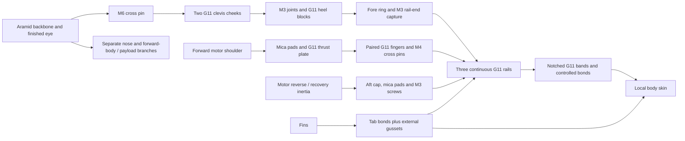

# S1 short G11 subframe — one bounded admission decision

**Do not admit S1 to detailed CAD or stress analysis.** The complete preliminary
budget misses G80 guide departure, and increasing mass also increases the
unchanged recovery-opening screen. The proposed M6 clevis then misses its
provisional contact screen even at the specified solids-only mass floor.
Its M3 heel screws also fail a minimum length stack. This is one evaluated
arrangement, not a pin/thickness search or a selected vehicle.

PR #41 is merged after both required jobs passed in run41359972531. It preserves
the bond-only bridge failure and stops both prior envelopes:

| Option | Controlling rejection | What the next concept must change |
| --- | --- | --- |
| B, rail-aligned capture | **Attachment:** 12.50 MPa projected plywood pin bearing versus generic10MPa screen; bearing/net-section dimensions conflict. Specified12mm pin cannot engage16.2mm fork width. Rail/ring/body outbound path remains unqualified. | Replace the narrow plywood primary capture, size real pin engagement, and demonstrate every outbound joint. Moving the load onto the rail does not qualify the rail. |
| C, long G11 frame | **Clearance and frame section:** strips intersect the coupler. Trimming to its bore leaves59.665mm², demanding29.87MPa versus estimated25MPa hot G11 before holes/joints. | Keep load members out of the existing coupler bore or explicitly redesign that interface. Provide real end and body/fin attachments. Mass was a penalty, not the basis of the first rejection. |
| S1, short G11 cassette and clevis | **Coupled recovery attachment/mass, guide performance and heel fit:** results below. No calculated temperature pass exists. | Revise the complete aft recovery termination and its mass budget together. A larger nominal frame or a bare net-section pass does not qualify bearing, foot capture, screws or body/fin joints. |

The physical bridge remains2mm thick;1.5mm was a mesh setting. Its3.965/4.007MPa
DF3 shear bounds remain above the estimated1MPa hot-bond screen. Force and
reciprocal-work agreement do not establish installed strength.

## S1 arrangement and explicit connections

G11 is glass-fibre/epoxy laminate. A clevis is a pair of plates with a pin
between them; a loop in the recovery line pulls on that pin. The subframe is
a separate internal cassette whose rails connect motor, fins and recovery
attachments. Geometry and quantities are owned by
[the S1 study specification](../configs/studies/wo03-g80-short-subframe.yaml).
All are proposed dimensions, not purchased or measured hardware.

No box in this diagram is a fixed ground. The independent recovery battery,
controller and arming arrangement remain in their existing upper package.
The nose and forward-body branches are still separate open interfaces; a new
aft frame cannot make the existing paper-body cut carry the whole parachute
force or qualify the forward branches.

| Connection | Proposed physical detail | Screen / missing evidence |
| --- | --- | --- |
| Backbone → pin | Existing nominal3.5mm Apogee30327 line corridor atR28/60° ends1009mm. Finished eye must turn toward a pin at1036mm, R23.7/60°, in a5mm gap. | Hot bend/eye efficiency, chafe and minimum bend radius unavailable. The straight-route clearance does not validate this bend, extraction or service loop. No knot strength credit. |
| Pin → cheeks | M6 nominal6mm pin,24mm shaft; two6.5mm-thick ×14mm-radial ×30mm-axial G11 cheeks,6.2mm holes;5mm clear gap | Net section101.4mm²; projected bearing78mm². Net and bearing are distinct; results below. Pin grade, locking, supplier tolerances and hot proof remain unavailable. |
| Cheeks → heels → fore ring | Two20×14×8mm G11 heel blocks; four transverse M3 screws connect cheeks/heels and four axial M3 screws connect heels to the6mm fore ring, with captive nuts/washers | The assumed M3×16 screws are **too short**: transverse minimum6.5+8+2.4+0.9=17.8mm, axial minimum8+6+2.4+0.9=17.3mm, both before protrusion. Full heel pose, pockets, hole stations, anti-rotation and prying remain unresolved. This incomplete connection is an independent admission stop, not a rigid support. |
| Fore ring → rails | G11 annulusR15.8–32.2mm,6mm axial at1010mm; three M3×35 end captures into6.6mm radial/2.6mm axial nut pockets in widened rail terminals | Sixteen-mm terminal width,12mm radial depth; source M3 nut5.5mm flats/2.4mm thick and9mm washer envelope. Pocket/washer seating, torque, tear-out and ring bending require actual geometry. No primary load is assigned to glue alone. |
| Continuous rails | Three180mm rails at1016–1196mm, R25,0/120/240°. Middle12mm radial ×10mm tangential; terminal regions widen to16mm.100×5.2×6.55mm fin pockets and stated nut/bolt bores are subtracted in the floor | Every hole/pocket reduces section. Whole-load sharing and local buckling are not accepted from gross area. Fore-ring flexibility, end moments and contact remain open. |
| Forward motor → rails | Source motor remains1072–1200mm. Three mica pads feed a9mm G11 plate at1060mm. Open rail notches clear the continuous rails; paired12mm-deep ×2mm-wall ×18mm-long fingers use three tangential M4 cross pins at1080mm | This explicitly replaces adhesive-only finger transfer. At352.59N factored forward thrust, ideal total finger root/net/bearing demands are7.35/11.30/22.04MPa. Generic25MPa screen gives1.134 minimum ratio, **not** hot bearing/root-bending capacity. Finger machining directions, corner stresses, pin bending/grade and thermal bridges remain open. |
| Reverse motor → rails | Source mica pads1200–1203mm,4mm aft cap1203–1207mm; change its three bolt axes to0/120/240° atR25. M3×35 screws, nuts and washers bear into widened rail terminals | 150N service ×DF3=450N once. Axial stack is explicit; actual cap bending, preload, one-bolt demand, threads/washer support and nozzle envelope still need checks. The old bridge/keeper and guides are removed, not retained as invisible supports. |
| Fins → frame/body | Retain6.35mm plywood fins,100×6mm tabs and paired12mm-span/3mm-base gussets. The new slot leaves0.1mm nominal side gap; only4mm radial tab overlap exists with the new rail | Two tab side faces provide800mm², not the full1200mm² of a wholly engaged6mm tab. Epoxy bonds and gussets are parallel paths; normal contact/peel cannot use the1MPa shear number. Gusset/body transfer, stiffness and flutter remain open. |
| Frame → body | Two20mm G11 bands at1030/1160mm, R31.2–32.2, three16mm rail notches each; controlled0.3mm shell bond. Six radial M3 screws and six20×15×2mm external spreader blanks locate/retain the assembly | Wide bond area replaces tiny rail-back films, but mean shear is not peel or paper strength. Radial screw bearing in0.5mm paper is not credited as the primary axial path. Actual notches, contact, outer patches, local crushing, body cut and coupler loads remain open. |

The fore thrust plate is **not** allowed to occupy the rail material. Its open
notches and integral fingers are part of S1; the M4 pins provide a finite
mechanical connection. This prevents silently turning an intersecting or fused
CAD part into a joint. No assembly-solid or interference pass is claimed.

## Quantitative admission result

The [executed record](../runs/wo03-g80-short-subframe-20261101-v1/record.json)
uses the unchanged archived schema/guide function and exact73-part canopy
source. It performs no CAD, FEA, transient heat or free flight. The separate
full50g allowance is always retained. Estimated source properties are G11
density1850kg/m³, E10GPa,25MPa hot scalar screen. A ratio of1 means demand
equals the screen; ratios below1 fail that screen. These estimates are not
material allowables or physical test evidence.

The original severe case remains20.4m/s stopped over0.3m with DF3 and gravity:

`F = 3 × mass × (20.4² / (2 ×0.3) +9.80665)`.

Therefore the factored demand is **2110.21995N per kg**, with the previous
1782.253N retained as a minimum floor. It must increase when mass increases.
No design factor is applied again to an already-factored force.

| Quantity | Result | Interpretation |
| --- | ---: | --- |
| Source canopy package | 794.582g nominal +50g =844.582g | Earlier1782.253N screen belongs to this mass. |
| Removed named source items | 139.061g | Mount/guides, keeper/bridge, itemized M3/M2 sets, old fore plate and aft cap replaced once. Old7g lump was already removed and is not credited again. |
| New cut-blank/component budget | 351.896g | All listed rails, rings, plates, clevis, pins, hardware, bands, reinforcement and extra glue/foil/line/service items included. |
| Complete preliminary budget | 1007.417g +50g =**1057.417g** | Net modeled addition212.835g. Cut blanks and allocations, not CAD-reconciled installed mass. Correcting short screws could add mass. |
| Mandatory-solid mathematical floor | 887.673g +50g =**937.673g** | Independent subtraction of all listed cuts over-subtracts overlapping cuts, so gives a lower solid mass **within this geometry and retained estimated ledger**. All steel, heels, body bands, glue/line/shield additions are omitted. It is not a measured physical bound. |
| Severe force at that floor / budget | **1978.696 /2231.382N** | The unchanged recovery case recalculated at the new masses. |
| M6 clevis net tension, budget | 22.006MPa; ratio**1.136** | Passes scalar25MPa net screen only. Holes, bending/laminate directions and actual peak stress unqualified. |
| Clevis projected bearing, floor / budget | **25.368 /28.607MPa**; ratios**0.9855 /0.8739** | Adverse even at the mandatory-solid floor.25MPa is still an estimated scalar comparison, not a qualified bearing allowable. No rounding or supplier flexural value closes it. |
| Full mass permitted by that provisional bearing arithmetic | **924.074g** | Already below the937.673g solids-only floor. It cannot be fixed by omitting a washer from the ledger. |
| M6 pin, preliminary budget | 39.46MPa double shear;236.76MPa uniform-eye bending diagnostic | Hot pin grade/proof, eye contact distribution and real end restraint unavailable. Successful steel arithmetic is not established by the G11 net result. |
| G80 guide, mandatory-solid floor | **15.185m/s** | Passes the old mass-only guide model; this excludes indispensable hardware. |
| G80 guide, full preliminary budget | **14.190m/s** versus15m/s | Fails on assumed1.5m usable guide with source lower thrust/upper drag/friction. No longer guide is adopted. |
| Maximum full mass in that source guide model | **958.398g** | Binary bracket958.397865–958.398104g; not a physical prediction to sub-milligram accuracy. |
| Mandatory solids + just the defined M3 sets | **985.079g** | Already26.681g above the guide-model ceiling before all other necessary components; the identified short screws are not an optimistic way to pass. |

The guide is a **mass-only screening calculation** with the prior frontal
area/drag assumptions. New external spreaders, manufacturing and aerodynamics
are unvalidated. It is not the earlier JAX flight result16.366m/s or a new
RocketPy comparison. No new altitude, CG/full tensor or flutter pass is assigned
to an unadmitted geometry.

In a three-axial-force-only frame freebody, the off-axis recovery pickup gives
1448.91/1448.91/−666.44N at the three rails for the budget mass. A negative
reaction means the far connection must carry the opposite force, not float
free. Force and moments balance, but those numbers are **not installed bounds**:
actual ring bending, finite rail/foot stiffness, end moments and contact could
change the allocation. No equal sharing or perfectly rigid ring proves strength.

## Fin, thermal and service consequences

The old historical panel case49.807N/1.74325N·m per fin becomes149.421N and
5.22975N·m with DF3. Matching52/72 fin dimensions do not qualify the changed
frame. A pure-shear couple over two fully active100×6mm faces at the estimated
1MPa shear screen can provide at most3.810N·m; at least1.420N·m must use other
paths **under that allocation**. The real gussets and normal/shear contact can
act in parallel. This is not a valid basis for rejecting the whole installed
joint, inventing a peel allowable or prescribing a unique tab thickness. S1's
4mm overlap makes the isolated shear allocation less favorable. Actual installed
gusset/body/frame analysis, stiffness and flutter remain prerequisites.

Thicker G11 rails, mechanical fore-plate pins and heel attachments change heat
paths into paper, bonds and recovery hardware. Source k=0.25W/(m·K) gives only
an isolated gross rail conductance of0.0005W/K for three120mm²/180mm rails;
it is not a connected heat solution or temperature bound. Solid barriers, open
notches, real seams, adhesive occupancy, metal pins and contact must remain in
the eventual qualified model. Required300°C case / contaminated foil /35°C
ambient through soak and the45°C paper/wood screen are unchanged. Temperatures
are **unavailable**; earlier failures remain failed, including the stopped
thermal method. No new custom heat solver is started.

Fore plate/fingers/pins, captive nuts and fixed frame joints must be installed
before the shell bands are bonded. Routine motor service would remove three
aft screws and the cap, then withdraw the motor aft. A nominal31.6mm ring bore
around29mm case does not prove nozzle, tolerance or tool clearance. Heel/pin
service, loop disconnection at an aft-module change, wire strain relief,
recovery extraction and arming access need actual paths and supplier envelopes.
The external spreaders alter the body surface; no unchanged aero claim follows.

G54 shares the coupler/upper interface but needs its own mass, motor and thermal
load screens. G12 has moving motor/gimbal reactions, long heating and its own
unconfirmed5m guide budget; S1 is not a G12 mechanical design. Its PID/RL
milestones and eventual finless transition remain committed. No shared change
is automatically propagated to either configuration.

## Documented design-change decision and stop

**Required interface revision: IF-RECOVERY-001, aft termination and foot.**
Replace the current slender clevis/heel proposal with a fully dimensioned
load-spreading attachment whose projected contact area and net section are
sized to the **updated full package mass**, not the old1782N figure. The specific
next direction is a rounded through-frame aramid saddle/strap capture into
substantial G11 terminal faces, with a justified finished-eye/bend capacity and
positive mechanical backup. It must avoid relying on narrow captive-nut seats,
friction, an unqualified glued foot or industrial lifting hardware. No second
concept is executed here and no thermal/material criterion is raised.

At the current budget, uniform25MPa sizing alone needs at least**89.255mm²**
projected contact (not the current78mm²), before local effects and mode-specific
properties. That arithmetic is a necessary scalar screen, **not a new approved
saddle size**. Full-growth mass must also stay within the unchanged guide
criterion or IF-GUIDE-001 requires a separately documented, verified equipment/
vehicle change. Do not silently adopt a longer guide or spend the growth reserve.

| Closure item | Result | What remains |
| --- | --- | --- |
| PR41 bounded comparison | **Closed and merged**, both required jobs passed | Its design failures remain failures. |
| S1 concept admission | **Rejected / not adopted** | Coupled termination bearing and guide mass fail; heel screw stack fails; foot fit/load path, body branches and installed fins remain open. |
| Recovery demand bookkeeping | **Corrected for this concept** | Same opening assumptions, new mass; not measured shock qualification. Future candidates must repeat this coupling. |
| Detailed CAD/FEA/refinement/flight | **Not admitted or run** | No consistent accepted snapshot; no inspector promotion or analysis overlay. |
| Physical qualification | **Later owner stages retained** | Exact lot/material/pin/termination evidence; representative hot bond/bearing/pin/foot and assembled proof, packing/deployment, modal/flutter measurements, independent recovery electrical tests. |

One requested-thread packet used0.385CPU seconds under10CPU/20wall-second limits;
the external supervisor exited normally. OS affinity is not claimed. No native
CAD/FEA/thermal solver or free flight was invoked. The read-only regrouping in
[decision audit](../runs/wo03-g80-short-subframe-20261101-v1/decision-audit.json)
uses the saved numbers without repeating an attempt. Stop here: no automatic
larger-pin, thicker-cheek, longer-guide or mesh sweep. The next finite admission
must resolve IF-RECOVERY-001 and the complete mass ledger together before any
native budget is reserved. WO-03 and all physical/purchase/paid/WO-10/flight
gates remain open.
