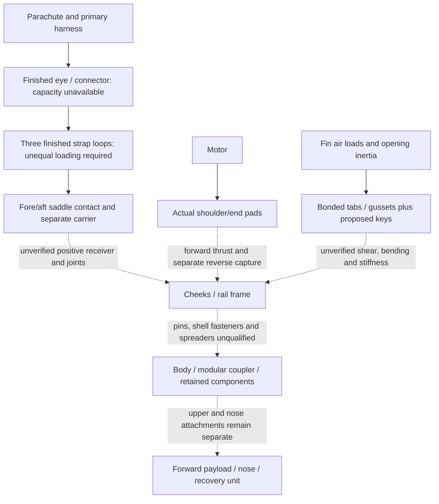

# G80 integrated aft construction decision

**No credible complete integrated aft architecture is selected yet.** The
saved S2 receiver leaves a 3.8 mm gap to the retained rail ends. A bounded
additive capture sketch closes that gap on paper but adds substantial mass,
repeats the adverse pin-bearing sensitivity and still has unverified fin,
shell, heat and service interfaces. It is eliminated at the preliminary
screen; no CAD, FEA or additional candidate campaign is justified for it.
The selected **interface direction, not a selected physical arrangement,** is to replace the retained wood
motor/fin frame and duplicate G11 carrier with **one positively connected
load-bearing aft receiver**. Its geometry is not yet selected, and removing the
retained frame is creditable only when all its thrust, fin and body functions
are actually replaced.

The fixed reference is the isolated `90b2a9…2bdfc` G80 package and the
separate 73-part canopy sensitivity; the metadata-corrected `6b0577…d1dc4`
identity is not the as-run YAML identity. S2's **932.677 g** including the
full 50 g growth is a mixed-assumption diagnostic, not a measured installed
mass or bound. Its fore collar 32→64 quadrature change exceeded the declared
0.05 g check; the later levels do not erase that stop. The original bridge
bond-only adverse results, S1 rejection and all thermal and service findings
remain open. The separate G54 and G12/PID-to-RL tracks receive no transferred
fit or strength claim.

S2 evidence is published in [merged PR #45](https://github.com/kudratsingh/rocket-twin/pull/45).
Both required jobs passed in run41370492131; those software checks do not
override the saved failed numerical or engineering checks. No stopped S2
calculation was repeated for this decision.

| Arrangement | Full-growth bookkeeping mass | Formal15m/s screen | Controlling limitation / admission |
| --- | ---: | --- | --- |
| Bond-only bridge | Same archived package; not a new ledger | Existing package guide result only | Factored face-mean hot shear3.965/4.007MPa exceeds provisional1MPa; force/work consistency is not strength. Rejected unchanged. |
| B rail capture | Complete installed mass unavailable | Unavailable | Pin engagement fails; optimistic full-width wood bearing12.50MPa exceeds10MPa. Rejected. |
| C continuous frame | Complete installed mass unavailable | Unavailable | Coupler interference; fitting leaves ideal29.87MPa versus25MPa hot scalar screen. Rejected. |
| S1 short cassette | 1057.417g estimated | 14.190m/s; fails | Clevis bearing, heel-fastener grip and mass. Rejected. |
| S2 saddle/strap | 882.677g nominal + separate50g =932.677g diagnostic | 15.230m/s; +0.230m/s, but−0.270m/s to15.5 planning | 3.8mm disconnected receiver, keeper grip, hot motor clearance, finished harness/contact and partial stability; volume check fails. Not admitted. |
| S2 plus additive receiver | 927.490g partial stock + separate50g =977.490g | Stock exceeds source-model15m/s mass ceiling by19.092g | Mass already adverse before unresolved hardware, plus wood-pin/contact/fit paths. Eliminated; no complete installed mass or speed claimed. |

There is **no installed recovery, fin, body or motor-retention requirement
closed by this comparison**. It closes the bounded admission decision: do not
spend detailed-CAD or stress-analysis resources on the additive arrangement.

## Why the additive receiver was rejected

The single screening sketch retained S2's separate carrier, fore and aft
collars and three closed aramid loops. Six 7 × 2 mm G11 cheeks would run from
station 1.069 to 1.2038 m alongside the three rail axes. The existing S2 fore
fingers would instead be six separate 7 × 2 × 18 mm inboard tongues occupying
nominal tangential offsets ±4–6 mm; nominal rail relief would be needed. The
cheeks occupy ±6.2–8.2 mm, nominally 0.2 mm clear of each 12 mm rail flank,
and would be integral with the aft collar. Three transverse M3 connections at
1.078 m and three at 1.195 m would bridge fore tongues, rail and cheeks. The
six cheeks extend across the **1.200–1.2038 m** gap, rather than assuming an
unphysical rigid support. The fore joint needs real bearing on the tongue and
pin, and the aft collar/cheek union needs manufacturable geometry; neither is
established by the sketch.

All stations below are measured aft from the nose tip; radial distances are
from the rocket axis, and dimensions are millimetres. The tabulated dimensions
describe the rejected sketch, not manufacturing drawings or accepted fits.

| Joint / region | Dimensioned intention | Actual remaining issue |
| --- | --- | --- |
| Rail to aft receiver | Six cheeks span1069–1203.8; last3.8 extends past rail end1200. Three rear pins at1195; nominal aft edge distance5 on rail and8.8 on receiver extension | This bridges the axial gap geometrically only. Integral cheek/collar section, holes, bending/contact, manufacturing and thermal stacks are unverified. |
| Fore tongue / rail / cheek | Tongues±4–6 tangential, cheeks±6.2–8.2; tongue engagement18; fore pin1078, assumed3.2 clearance hole for3 nominal shaft | Tongues require rail relief, leaving8mm ideal net rail width before drilling. The nominal0.2mm side gap can be consumed by tolerances/expansion. |
| Fastener grip | Thread length22; grip16.4 + washers1.8 + nut2.4 =20.6; nominal projection1.4 | No actual grade, worst-case grip, thread runout, head/nut envelope, locks or tool path. Source2.84g set weight is a placeholder, not a selected22mm fastener. |
| Cheek to body envelope | Intended radial25–32, tangential6.2–8.2, within existingR32.2 frame boundary | Rectangular outside corners exceed the cylindrical boundary. Clipping changes section, pin ligament and mass; no hidden fit/section credit. |
| Fin to rail | Three axial3×15 keys atR28.5,1185–1200, intended5mm tab /10mm rail engagement; existing bonded tab/gussets remain | Key engagement, edge distance and stops not resolved. Stock stop mass has no accepted geometry. A tangential rail bolt does not by itself restrain fin-normal force. |
| Body to frame | Twelve proposed radialM2 sets at1110/1165;6×6×1 G11 washer blanks | Paper bearing, tear-out, shell cut paths, bolt grip, access and installed stiffness unverified; a small washer does not qualify the0.5mm shell. |

The intended load paths expose the unclosed connections:

Solid arrows identify the intended local contact sequence, not verified
capacity. Dashed arrows remain design acceptance blockers. Recovery compression
must close through the independent carrier and receiver; motor forward thrust,
reverse retention and fin bending need their own real joint reactions. No
perfect support, friction-only end restraint, equal loop loading or motor-case
compression transfers those forces across an absent joint.

A nominal M3 × 22 mm thread-length stack has 16.4 mm grip, 1.8 mm of two
washers and 2.4 mm nut, leaving 1.4 mm nominal projection before tolerances.
This does not establish head/nut access, actual fastener properties or
clearance. The fore-tongue relief leaves only an ideal 8 mm of the original
12 mm rail width at the pin section. Under a **single-pin** 450 N factored
retention sensitivity, hypothetical full pin-to-wood bearing is 18.75 MPa and
net rail section is 14.80 MPa, versus the generic estimated 10 MPa plywood
screen. These are conditional diagnostics, not qualified bearing or joint
allowables, and load can also transfer directly between G11 tongues and cheeks.
The clipped cylindrical envelope, ring intersections and exact force paths
remain unresolved.
The net-section sensitivity uses an explicitly assumed3.2mm transverse hole:
`450/[8×(7−3.2)]`; projected bearing uses `450/(3×8)`. The450N is the existing
150N reverse-service screen multiplied by DF3 once, not recovery load and not a
proved single-joint reaction. G11 tongue/cheek contact can change distribution,
so these wood values cannot be treated as an installed solution.

The sketch also needs fin and shell capture, not just motor retention. For
bookkeeping it names three axial Ø3 × 15 mm G11 fin keys at R28.5, spanning
1.185–1.200 m, each intended to engage 5 mm of fin tab and 10 mm of rail, with
three rear stops; and 12 proposed radial M2 through-fasteners with external
6 × 6 × 1 mm G11 washer blanks at stations 1.110 and 1.165 m for the shell.
Those positions are not a verified fit, joint or service sequence: pin shear,
fin end tear-out, shell's 0.5 mm paper bearing, screw grip and access, and
interface overlap must all be checked. It would be incorrect to treat a
transverse rail pin, whose axis is parallel to the fin-normal load, as an
independent fin shear key. Even if geometry were feasible, the modeled
motor-retention path must close through the fore collar, cheeks and aft collar
**without relying on the recovery straps or the motor case as a compression
rod**. The aramid loops and separate backbone then transfer recovery load to
the same actual receiver; no equal loop or pin sharing is assumed.

## Mass and guide decision

The following is a **partial stock ledger**, not an installed mass, a bound or
a demonstrated fit. The S2 subtotal already retains the source 12 g finish,
8 g fin-bond, 4.620 g mount-gap, 1 g locking and 5 g canopy sensitivity
allocations, plus the independent full 50 g growth. It also includes S2's
47.101 g carrier, 38.950/46.809 g collar estimates, 2.797 g fore fingers,
19.265 g three raw-webbing loop estimate, 9.843 g backbone/branches, 12 g
Softlink and the 16 g named S2 fastener, adhesive, shim, sleeve and service
allowances. The original S2 removed items remain counted only once.

| Additional additive-sketch stock item | Bookkeeping mass |
| --- | ---: |
| Six full-length 134.8 × 7 × 2 mm G11 cheek blanks | 20.948 g |
| Six M3 sets, using existing 2.84 g/set source weight only as an unverified placeholder | 17.040 g |
| Three Ø3 × 15 mm G11 fin-key blanks and three stop blanks | 0.745 g |
| Twelve radial M2 sets at source 0.44 g/set plus twelve G11 shell washer blanks | 6.079 g |
| **Added subtotal** | **44.812 g** |
| **S2 diagnostic + added subtotal, including growth** | **977.490 g** |

This subtotal omits actual ring relief, replacement hardware weights and
procurement, local reinforcement, extra process adhesive, any new thermal
shield, fin-key/bolt locks and verified assembly/service clearances. It does
not credit unmodeled material removal. It is therefore not a final mass, CG,
inertia or acceptance result. Nevertheless the named subtotal alone is about
**19.09 g above** the existing **958.398 g** full-mass guide-screen ceiling
for 15 m/s and about **73.64 g above** the separate **903.854 g** planning
screen for 15.5 m/s. The retained frame's approximately **34.39 g** after
S2's estimated bore cuts cannot simply be discarded while relying on its
rails, fin slots, thrust and body connections. Nor can the prior 7 g
unitemized fastener budget be removed a second time.

## Required interface closure for a replacement

A future single receiver must provide a continuous, finite structural path
between the recovery termination, both motor ends, fin shoes and body/coupler
without unverified ring bonds, friction, equal sharing or a rigid ground. Its
main axial webs must remain continuous through fin and pin features; any
outboard fin shoes and positive keys must have real edge distances, grip and
load paths. The fin tab/gusset, 0.5 mm shell and forward body/coupler each need
independent attachment and bearing/peel evidence. Full hardware, three finished
strap loops, connector, abrasion/heat protection, adhesive, locks and access
must appear once in the mass, CG and full-inertia model. Supplier raw webbing
and marine softlink breaking loads are not finished hot dynamic harness
allowables. Finished-loop seam strength, minimum bend radius, full loaded
connector envelope, tolerances, extraction and service access are still
unknown.

The pinned motor study uses a 128 mm nominal length and 128.2 g source mass.
A separate current supplier audit reports a **124 mm casing length** for a
polymer-case G80; casing length need not equal the assembled motor envelope.
Neither establishes the actual nozzle projection, assembled end-to-end size,
axial growth or hot end properties. The unchanged 300 °C source-case matrix
and its possible closure of nominal endplay remain unresolved. A later
receiver needs either measured assembled geometry/thermal growth or a
positively retained floating capture that accommodates a justified envelope;
the commercial motor case is not credited as a structural load member.

The source configuration and saved S2 records are pinned in
[the study YAML](../configs/studies/wo03-g80-integrated-aft-proposal.yaml).
The named stock arithmetic is a hand screen; no new CAD, FEA, thermal solver,
free-flight or purchasing action was performed. Ordinary sketch arithmetic was
not separately instrumented. One subsequent saved-data arithmetic packet was
declared at one CPU,2CPU-seconds/5wall-seconds with no automatic retry; its
read/compute section completed in0.003919CPU/0.004183wall seconds. Imports,
setup and earlier hand work are not included in that timer. See
[the exact calculation record](../runs/wo03-g80-integrated-aft-decision-20261102-v1/record.json).

## Coupled opening, balance and clearance screens

The stock subtotal gives a conditional new demand, **not a frozen installed
load**: `3×0.977489638×(20.4²/(2×0.3)+9.80665) =2062.718N`.
The nominal5m/s case is150.944N. Both retain the full loaded mass and separate
50g. The stopping distance and design factor are unchanged; neither equation
predicts measured peak tension. Any later complete ledger requires another
opening-force calculation. The old1782.253N and S2's1968.154N are historical,
not the demands for this heavier sketch.

Retaining S2's point-junction geometry as a sensitivity, without equal sharing,
raises one-branch tension to2638.117N and mean curved pressure to25.966MPa.
The provisional25MPa ratio becomes0.963, already adverse. This is not an
installed force solution or a qualified contact allowable. Finished stitched
eyes, loaded bend/edge effects, chafe, unequal loading, connector direction,
temperature/time degradation and stitch strength remain unavailable. Raw
webbing tensile strength or a marine connector breaking load supplies none of
those missing allowables. Required physical hot-loop/joint/pull tests remain
in WO-09–11 after design acceptance.

A deliberately broad **bookkeeping sensitivity** places the44.812g added stock
between1069 and1221mm, retaining S2's partial old-CG sensitivity. It gives
balance point840.742–860.157mm and, with the old source aerodynamic-force
location906.140mm,0.991–0.697cal versus the unchanged1cal requirement. These
are partial assumed placements and an old aerodynamic model, not physical
uncertainty bounds or a new static benchmark. They reinforce rejection rather
than qualify stability. Complete balance and resistance to rotation—the full
inertia tensor—remain unavailable until all parts and stations exist.

Nominal diameters alone do not establish clearance:29mm motor in29.4mm liner
bore leaves0.2mm per side;30.24mm outer foil inside31.6mm carrier leaves0.68mm;
35.2mm carrier in35.6mm ring bore leaves0.2mm. No manufactured/thermal worst-case
pass follows. The saved S2 axial-growth sensitivity gives−1.935 to+0.518mm
endplay, exposing possible interference. A case touching both ends could
become an unintended structural strut. Actual polymer-case expansion,
nonuniform heating, nozzle/shoulder shape, contact and pad properties are
unknown; aluminum expansion cannot be substituted. Keep the required
300°C/contaminated-foil/35°C case and45°C paper/wood screen.

The extra cheeks, pins, collars and body contacts also change heat paths and
shield-end openings. No thermal result is transferred from an earlier baffle.
The aft access sequence is not resolved: pins and radial nuts need tool paths;
closed straps need an installation and removal method; motor capture must be
removable without unthreading the primary recovery harness; the connector and
recovery unit need retained clearance and independent power. No straight-line
cord envelope or keep-out omission counts as packing or service acceptance.

## Specific architecture change and next admission gate

**Change the aft load-bearing interface, not the guide or force requirements.**
Replace the duplicated wood motor/fin frame and separate heavy G11 carrier/
collar arrangement with one continuous receiver that positively connects the
primary harness, fin shoes/keys, both motor restraints and body/coupler. The
receiver must bypass the weak serial paper-wall cut for primary recovery force
while positively retaining the body and components it supports. This specifies
the required roles; it does not select another geometry or claim one exists.

The gross replacement ledger makes the constraint explicit. The source73
nominal794.582g plus50g, minus the **named139.061g source bundle once**, leaves
705.521g. All replacement structure, straps/eyes, pins, locks, reinforcement,
adhesive, heat protection, service and motor hardware together have at most
**252.877g** at the formal15m/s mass screen, or **198.333g** at the separate
15.5m/s planning target. These are ceilings in the saved guide model, not free
credits or selected-package masses. Source fins, recovery equipment,12g finish,
8g fin bonds,4.620g gap budget,1g locking and5g canopy allocation stay counted
unless an explicit replacement preserves their function. Do not subtract the
former7g hardware lump again. A finished ledger must include credible mass
uncertainty as well as a useful guide margin; targeting a rounding-level pass
is not an admission strategy.

Before another design iteration can enter detailed CAD or stress analysis,
the proposed interface must have dimensioned, physically meeting load joints;
finite support/contact stiffness or justified bounds; actual fastener grip and
removal paths; finished harness/contact assumptions; a manufacturing/thermal
motor-clearance envelope; and a complete coupled mass/opening/CG/guide screen.
If these cannot fit the198.333g planning envelope without losing functions,
stop and document the precise interface/construction trade. Do not silently
turn15.5 into the formal gate, lengthen the guide, lower recovery demand or
raise a material limit. No expensive analysis or additional variant was
admitted in this decision.

| Requirement/interface | What this increment resolved | Result / next evidence |
| --- | --- | --- |
| IF-RECOVERY-001 / RT-LOAD-001 | Exposed the complete intended endpoint/frame/body chain and recalculated the heavier stock's demand | **Design open**; positive joints, finished hot eyes/contact and retained-component paths need design evidence, then owner proof/opening tests. |
| RT-GUIDE-001 / RT-MASS-001 | Quantified additive failure and gross common-receiver budget with full50g once | **Additive rejected**; a complete selected package and existing guide/flight checks remain required. |
| RT-MASS-002 / RT-STAB-001 | Recorded adverse partial-CG/old-CP sensitivity and unavailable full tensor | **Design open**; same-configuration mass/inertia/aerodynamics and RocketPy checks required. |
| IF-MOTOR-001 / RT-FIT-001 / RT-THERM-001 | Distinguished independent thermal capture from motor-case structural credit | **Design open**; actual supplier envelope/material bounds, positive clearances, qualified heat method and required matrix; later owner measurements. |
| RT-LOAD-002 / RT-FLUTTER-001 | Kept actual fin joints and flexibility separate from isolated panel evidence | **Design open**; installed strength/stiffness/flutter at the selected full configuration, followed by later physical validation. |

The working vehicle, archived72-part inspector, failed thermal results and
preview geometry are unchanged. G54 needs its own complete retention, stability,
supplier and thermal evidence. G12's moving mount, long heat exposure, guide
mass and PID-to-RL goals remain separate; a fixed G80 receiver cannot be
transferred as a trainer solution. WO-03 and all later physical/purchase/paid/
firmware-review/flight-release gates remain open and unchanged.

Current supplier evidence relevant to the next connection is
[AeroTech's G80-10T product specification](https://aerotech-rocketry.com/products/product_bea030f5-871e-61ef-1279-45a2bbebbd87)
(polymer case and124mm **casing**, not a complete assembled drawing),
[AeroPack's fit table](https://aeropack.net/pages/reference-lists-for-correct-fit-of-motor-retainer-to-motor-mount-tube)
(29L2 intended for31.115mm tube OD, not S2's35.2mm carrier), and the
[Bally raw-webbing table](https://www.ballyribbon.com/mil-spec/kevlar-webbing).
None supplies the missing installed hot connection allowable or motor expansion
history. No product is selected or purchased here.
