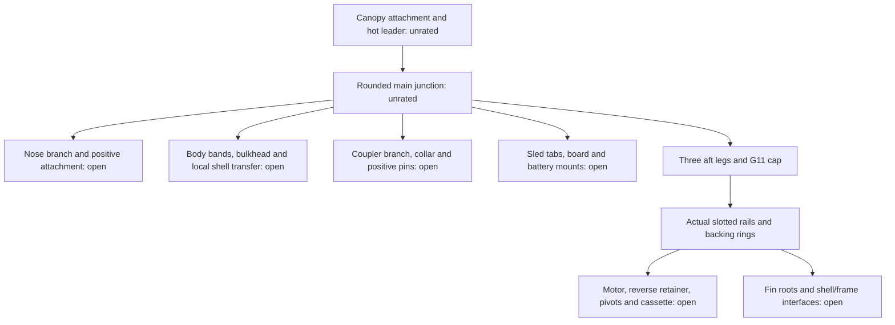

# WO-03 recovery bill, forward-cap trial and opening-load audit

Committed numerical projection: [complete recovery/motion/opening evidence](../runs/wo03-recovery-closure-20261031T020015531834Z/record.json). Raw CAD, pose and telemetry artifacts remain local with recorded identities.

**The combined design remains open.** The explicit recovery increment is **66.081 g** for the G12 trainer, retaining the original 5 mm upper plate, independent controller/power package, full 8 mm recovery port sections and an actual rounded nonmetallic junction. Reconciled construction provides **76.856 g** of conditional headroom including the prospective rail saving. An 8 g thermal mass sensitivity then passes the unchanged guide arithmetic with approximately **2.774 g** margin. The coupled horn/rod layout still interferes with the cassette/motor during combined motion, and matched/single-leg recovery transfer fails the estimated G11 rail screen. A passing mass subtotal cannot close these findings.

Run:

```sh
.venv/bin/python scripts/wo03_recovery_budget_closure.py --preset tiny
.venv/bin/python -m pytest -q tests/test_recovery_anchor.py
```

The executed record is `build/wo03-recovery-budget-closure/record.json`, run **`wo03-recovery-budget-closure-20261031T020015531834Z`**: **81.30 s local CPU, $0, unchanged recorded inputs**. Its four resolved mass copies reload through the vehicle schema. It writes the trainer's standalone anchor/junction STEP files and actual shared-core inflation traces. These ignored outputs retain source hashes, per-part mass ledger, removal ledger, identities, force partition and limitations. Three focused unit checks pass. No active specification or CAD generator was changed. Generic whole-vehicle CAD regeneration cannot yet reproduce the new rounded saddle and junction operations; the standalone script and its STEP artifacts are the geometric evidence.

## Complete counting boundary

The original dedicated recovery bill is **111.034 g**: canopy, old cord/protection/bulkhead/anchor, EasyMini, dedicated 1S battery, separate rotary switch, carrier/pins/mount allowance and recovery output wiring/connectors. These stay separate from the main battery. The isolated packaging copy adds **4.765 g**, including its real controller mounts, cell tray/band, six carrier fasteners, local reinforcement, switch doubler and retained residual allowance. The 4 g output harness remains; a lighter connector, removed switch or shared battery is not credited.

The revised cut plan contains nine physical pieces and **18 ends**. The old 14-end envelope covered one main, three aft legs and three upper branches. A separate hot leader adds another physical piece/two ends, and an independent coupler branch adds another piece/two ends. No knot or termination-strength credit is taken.

| Piece | Material | Standing length | Preparation counted |
|---|---|---:|---:|
| Main cool section | HMPE | 0.95 m | 2 × 0.20 m |
| Main hot leader | Aramid | 0.25 m | 2 × 0.20 m |
| Three aft legs, each | HMPE | 0.43 m | 2 × 0.20 m each |
| Nose branch | HMPE | 0.48 m | 2 × 0.20 m |
| Body branch | HMPE | 0.16 m | 2 × 0.20 m |
| Coupler branch | HMPE | 0.35 m | 2 × 0.20 m |
| Sled branch | HMPE | 0.32 m | 2 × 0.20 m |

At the existing 4.5 g/m HMPE and estimated 8 g/m aramid inputs, total line mass is **35.575 g**. G80 needs longer 0.47 m aft legs at its actual forward-plate station; the per-mode cut plan charges that difference. The 200 mm preparation allowance is still an unverified cutting envelope. It is neither a demonstrated Samson pick/tuck length nor an established aramid termination method. The standing lengths allow nominal axial routing; eye dimensions, packing, end order, bend radii and service loops remain unverified.

An additional **8.401 g** comes from a Boolean-modelled G11 junction ring: 30 mm OD, 10 mm ID, 8 mm thickness, 3 mm edge fillets, centered at station 0.600 m. It fits the nominal bore and has no rigid intersections. Its rounded section does not establish eye crowding, contact, load distribution, laminate strength or an installed rating. The existing 2 g stitching/termination allowance is retained in addition. Body bands 1.174 g, sled tabs 2.165 g, seal/grommet 1.5 g, sleeve 3 g, adhesive/fillets 2 g and provisional positive coupler pins 0.8 g are also charged. The pins remain a reserve rather than implemented qualified hardware.

| Mode | Recovery increment including carrier, all line pieces and junction |
|---|---:|
| G80 | 51.725 g |
| G54 | 52.144 g |
| G12 finned, forward-cap/canted-horn trial | 66.081 g |
| G12 finless, forward-cap/canted-horn trial | 66.081 g |

Shared baseline structure remains in fixed vehicle mass. New recovery frame material is charged to the recovery increment even though the part is structurally shared; the whole frame is not counted a second time. The trainer recovery allocation is **177.115 g** including the baseline. Its separate construction changes are approximately **−66.011 g**: main battery, final backed fin assembly, actual forward slot/channel cuts and reconciled interface adhesive. The two ledgers reconcile to the complete copied vehicle mass.

## Combined G12 guide result

The construction reference is `build/wo03-trainer-fin-root/pvc5-forward25-backed-reconciled/resolved-candidate.yaml`, file SHA-256 `999230401433e8573ad8e817e554ba3bd8d2f94ce451fa921e47ce1fa4b5f682`. Its **81.948 g** fin assembly includes thin carbon skins, 5 mm nominal PVC core, solid plywood root/tab, gussets, adhesive/potting, glass caps, sealing and actual 0.5 mm frame-to-paper backing pads. Its explicit tab/gusset/foot adhesive already charges **3.627 g** of the old 8 g `fin_bonds` reserve. Reconciliation retains **4.373 g** of residual fillet/application allowance; all newly introduced skin/core/cap/seal/backing materials remain additional. This exact-once correction provides the additional headroom, rather than reducing an unmeasured interface allowance to force a pass. The copied main battery is 13.3 g and forward slot/channel cuts save 0.776 g. Pulse/ESR/temperature, installed root, directional material, peel and flutter requirements remain open.

At **5 m usable guide, 10 m/s minimum departure, lower-thrust/drag/friction assumptions and all 50 g growth retained**, the conditional maximum recovery increment is **76.856 g** with the unadopted 2.111 g rail saving, or 74.745 g without it. Actual guide availability remains unconfirmed.

| Additional thermal mass | Margin with prospective rail saving | Minimum departure across 1/0.5 ms steps | Guide result |
|---|---:|---:|---|
| 0 g | +10.774 g | 10.21211 m/s | Arithmetic pass only |
| 8 g | +2.774 g | 10.05435 m/s | Arithmetic pass only |
| 12 g | −1.226 g | 9.97606 m/s | Fail |
| 14 g | −3.226 g | 9.93705 m/s | Fail |

Without any prospective rail saving, the 8 g thermal sensitivity still gives **10.01298 m/s** and **0.663 g** mass margin. This very small margin does not absorb unimplemented attachment hardware or demonstrate that an 8 g thermal solution actually exists.

These thermal entries are mass sensitivities, not compatible thermal hardware. A thicker wall changes the bore and therefore the backing-pad/interface geometry; adding masses alone does not demonstrate their combined fit.

## Forward-cap correction and actual force paths

The original full 8 mm cap at 1.020–1.028 m intersects the nominal gimbal links by approximately 51.4 mm³. One link occupies the assumed port bridge near CAD `(28, 5) mm`, so a clearance cut cannot preserve the previous section screen without reanalysis. Moving the same cap to 1.012–1.020 m also cannot clear links that begin at 1.012 m and radius 28 mm.

An earlier copied correction put the cap at 0.999–1.007 m, with saddles to 1.010 m and a 181 mm frame. It cleared links but intersected `servo_support` by 908.7 mm³ and the two servos by approximately 1027.9/1001.7 mm³. That trial is rejected.

The current trial puts the full cap at **1.012–1.020 m**, saddle tops at 1.023 m, and extends the existing rails 8 mm forward to a **168 mm frame**. Native per-ring options preserve the **1.100 m pivot, 1.177 m rear ring and 1.065 m fin-channel start**. It charges approximately **1.232 g** more than the earlier anchor. The BRep is one valid solid; continuous qualified laminate, manufacturing route and actual joint integrity are not established by that Boolean result.

Reversing the original 6 mm horns to radius 16 mm cleared the ring but created a 5.447 mm³ neutral rod/cassette interference; that route is rejected. A proposed tangential XY arm is parallel to the current physical shaft axis and cannot actuate the linkage. The bounded valid alternative cants each actual 6 mm arm aft in its existing XZ/YZ rotation plane, with matching rod starts and unchanged shafts/gimbal destination lugs. The 115° diagnostic copy clears neutral geometry and closes the fixed-length equations at 25 poses, requiring up to **54.316°** shaft travel. The complete moved-part checks find nonjoint interference in **11 of 25 poses**, including rod/cassette **32.358 mm³** and rod/motor **15.616 mm³**. The 120° and 125° corner probes also fail. No port weakening, thrust-stop relief, motion-limit reduction or servo-authority claim is used to hide the failure.

The record checks every pair containing the changed frame, junction, rods or horns against every modeled rigid part under the nested motor/gimbal transforms. It retains raw contacts and separately applies the existing 4 mm endpoint-zone policy from `src/cad/verification.py`. The reporting threshold is 0.05 mm³, with no manufacturing-tolerance bound applied. Actual minimum BRep separations across the 25 poses are **0 mm rod/cassette**, **0.782 mm horn/frame**, **2.454 mm rod/frame**, **44.498 mm rod/coupler** and **0 mm rod/horn** including the declared mating neighborhoods. Zero separation is not a clearance pass. The minimum sampled kinematic rate ratio is **0.06147**, below the currently configured **0.16**; the source actuator-rate assumption cannot be carried into this new linkage unchanged. Torque, spline, joint strength, backlash, continuous motion and authority remain unqualified.

The force graph assigns every part once:



Demand is `3 × m × (v²/(2 × 0.3 m) + g)`, with the project factor applied once. Every case includes the full 50 g reserve on the aft branch. Line/hardware mass is assigned to its actual intended branch. Branch sums balance to the whole vehicle; balance does not provide a capacity. Nominal 5 m/s, 20.4 m/s and the available historical 12 s no-canopy timing probes are recorded. The historical speed is a sensitivity transferred to a new mass copy, not a fresh flight result or selected delay.

For G54, the updated late probe gives **2,490 N** factored whole-system demand, **1,518 N** on the separately tethered aft group and approximately **1,389 N** beyond the fore-plate inertia. Three clipped plywood ends retain only **660 N** of combined estimated axial screen. Their load path fails. Calling the finger-bond mean shear small does not supply the missing axial capacity. The nose/body/coupler/sled branches have assigned loads and counted hardware, but still lack actual rated attachments. The body gross-section proxy also fails in the severe case; bands must not be treated as a proven bypass for shell tear, peel or slip.

For the copied trainer, actual BRep sections give **27.738 mm²** per uncut rail and only **15.836 mm²** through the fin-channel region. At the existing 25 MPa estimated G11 hot screen, a critical rail carries **395.9 N**. The 20.4 m/s aft demand is approximately **1,029 N**: equal three-leg sharing gives 343 N each and passes the proxy, but the existing unmeasured length/EA bound gives **783 N**, and a single leg gives 1,029 N. Both fail. At most 38.5% of the aft demand may enter one critical rail under this estimate. Uniformly enlarging all rails enough for the single-leg bound requires approximately **23.6 g** of additional material before fit, motion or local-joint details; it is not a feasible saving or an adopted fix.

Recovery puts these rails in tension. Separate ideal pinned-column calculations at the reused estimated hot `E = 5 GPa` give approximately **148 N** for three rails over the 76 mm front-to-pivot clear span and **30 N** for an entirely unbraced 168 mm span. These are weak-axis/Euler sensitivities with assumed end restraints; no new eigenvalue or assembled thrust buckling pass is claimed. Ring restraint, shell backing, local material directions and all actual interfaces remain open.

## Canopy inflation and snatch are different demands

The new audit calls **the actual shared JAX derivative and RK4**, subtracting its recovery-disabled acceleration from its recovery-enabled acceleration to extract canopy force. It preserves the 0.75 m diameter, `Cd = 0.75`, 0.3 s linear inflation and barometric lag. It starts at a prescribed descending speed after burnout, includes the full 50 g mass reserve, uses the copied G54 mass and integrates one second with 1 ms steps. This is a local load audit, not a new flight trajectory or opening validation.

At the historical G54 late-probe altitude **1553.79 m MSL**, `CdA = 0.331340 m²` and density is approximately 1.0524 kg/m³:

| Starting downward speed | Shared-core peak during inflation | Peak × DF3 | Full-open drag held at starting speed |
|---|---:|---:|---:|
| 5 m/s | 7.675 N | 23.024 N | 4.359 N |
| 20.4 m/s | 35.140 N | 105.420 N | 72.560 N |
| 23.139 m/s | 41.077 N at 0.221 s | 123.232 N | 93.355 N |

The 5 m/s case accelerates downward during inflation, explaining why its transient force exceeds full-open drag evaluated at the initial speed. At sea level the late-speed shared-core peak is 43.781 N, versus 108.663 N full-open drag held at the initial speed. The smooth finite-mass inflation model decelerates the payload while drag area grows.

The 0.3 m stop proxy implies approximately **892 m/s² net deceleration**, approximately 91 g, at 23.139 m/s. Using physically depleted copied mass plus reserve, **0.823335 kg**, it demands **2,228 N with DF3**. That is equivalent to an unqualified opening multiplier of **7.96** over fixed-speed full-open drag at the late-probe altitude. The earlier retained structural screen additionally uses loaded motor mass conservatively. Neither calculation is the simulator's actual canopy force, and its 0.3 m distance is not an opening measurement.

[NASA's Cruz, Kandis and Witkowski opening-load paper](https://ntrs.nasa.gov/api/citations/20030065911/downloads/20030065911.pdf) distinguishes inflation aerodynamic/apparent-air-mass terms from the earlier snatch load. Its coefficients and large disk-gap-band test results are not applicable ratings for this hobby canopy. The shared core omits apparent air mass, overinflation, cloth/line inertia, elastic harness and slack-line snatch. The record gives opening-multiplier sensitivities rather than selecting a measured coefficient.

For two initially free groups, relative energy is `E = ½ μ Δv²`, where `μ = m₁m₂/(m₁+m₂)`. A 35 g canopy against the remaining copied vehicle has **8.972 J** at an assumed 23.139 m/s relative speed. Including the 33.017 g nose in that moving group gives **16.705 J**. Full falling speed is not automatically relative deployment speed; these are explicit fault sensitivities. For linear elastic arrest, `Fpeak = 2E/stroke`:

| Moving group | Peak × DF3 at 30 mm stroke | Peak × DF3 at 300 mm stroke |
|---|---:|---:|
| Canopy only | 1,794 N | 179 N |
| Canopy plus nose | 3,341 N | 334 N |

The canopy/nose pair would require at least **167 mm** of linear stroke and stiffness no greater than approximately **1,197 N/m** to limit the unqualified peak to 200 N before DF3; the canopy-only pair requires at least 89.7 mm and stiffness no greater than 2,229 N/m. The record supplies several candidate force limits and strokes. Continuing aerodynamic work and added air mass are excluded from this two-body collision calculation. If the canopy is effectively held by air, the relevant full-system kinetic energy can approach **220 J**, rather than 9–17 J. These calculations therefore do not establish a complete deployment-energy bound.

A bounded compliant-section source search found [Paskal's 6 mm shockcord sheet](https://www.paskal.com.au/media/productattach/t/e/technical_specification_shockcord_2025_2.pdf), with a polyester jacket, natural-rubber core, mass and quasi-static force/strain points. A 0.6 m piece weighs **18.740 g** and reaches approximately **64.72 N** at 0.6 m extension. Piecewise-linear integration, including an assumed zero-force relaxed origin, gives **21.448 J** to 100% strain. These typical points do not establish a dynamic/hot/aged curve, end efficiency, retained strength or rocket suitability. The sheet's breaking terminology is not promoted to a working load or guaranteed minimum. This candidate is **not selected**: replacing the 6.075 g cut HMPE main piece already adds at least **12.665 g**, before both terminations, a separately rated backup or heat protection. A finite-stroke backup can itself cause snatch if it engages too early.

The immediate requirement is a complete main-section force/stroke/work envelope, physically staged attachment and counted installed mass. Any compliant device must demonstrate its dynamic force curve, sufficient usable travel, end retention, heat/aging exposure and a compatible fail-safe path. Pull calibration, representative proof and deployment tests remain owner work. **The failed 0.3 m structural screen remains in force until a supported load-case rationale and bounded snatch design are reviewed.** It was not replaced by smooth drag or by the illustrative rubber curve.

## Remaining acceptance boundary

Correct the ring/servo layout, demonstrate actual ring/rail/shell/motor and separate upper-component attachments, and reconcile the full thermal, backed fin, recovery, electrical and construction package on one copy. Then execute required material-direction/contact, motion/tolerance, installed-root/flutter, static and affected JAX/RocketPy checks. The current record explicitly retains unavailable capacities as null and all acceptance/release flags false. Purchases, hardware fabrication, proof/deployment tests, paid runs, WO-10 firmware/abort review and flight release remain their existing owner gates.
